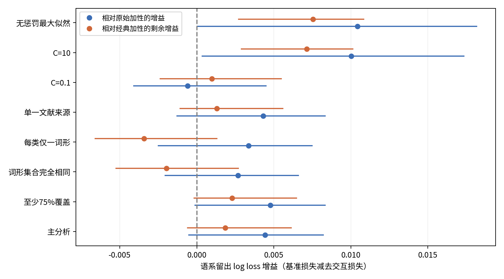

# 亲属称谓的语义组合：跨语言兄弟姐妹词形共享研究

本仓库保存已经执行的公开数据库分析、当前中文研究工作稿、文献全文和可复现结果，并提供后续研究与复查交接。

研究的问题是：所指者性别、相对年龄和参照者性别的独立贡献，能否预测两个兄弟姐妹类别是否共享词形？加入传统“同性／异性兄弟姐妹”特征之后，进一步的组合项还能带来多少跨语系预测增益？

## 研究与主要结果

主样本包含 **939个语言记录系统、125个谱系组、26,292个无序类别对**。研究以Kinbank词形记录为基础，使用Glottolog官方分类整组留出语系，比较三个模型：

| 模型 | 语义编码 | 设计秩 |
|---|---|---:|
| 原始加性 | 所指者性别、年龄、参照者性别差异 | 4 |
| 经典加性 | 原始差异加传统相对性别 | 5 |
| 完整两两交互 | 原始差异及其全部两两乘积 | 7 |

完整两两交互对七种非零差异组合具有饱和表达能力。主设定为固定岭惩罚 `C=1`，以未见谱系组上的语言等权平均对数损失衡量预测表现：

| 完整交互相对的基准 | 对数损失增益 | 95%谱系重采样区间 |
|---|---:|---|
| 原始加性 | 0.004423 | [-0.000510, 0.008205] |
| 经典加性 | 0.001843 | [-0.000604, 0.006120] |

正值表示完整交互的损失更低。主结果为小幅点估计改善，两项区间均包含零；传统相对性别之后的剩余增益随词形定义和惩罚设定变化。这里测量的是跨语言总体词形共享的预测结构，全部预设敏感性结果随论文和代码保存。



## 文献与阅读材料

当前正式引用 **46项独立学术著作，全部具有PDF全文和同名TXT**。仍未取得全文的A02与A05已从正文引用和正式参考文献中排除。文献库共保存 **51个源PDF及51个TXT**；额外5个文件是早期版本或补充材料，不重复计数。

2026年10月15日收到用户补充8份PDF，已核对题名、作者与版本，并统一命名为“编号_第一作者_年份_题名”。B03与C12现以正式期刊PDF为主要依据；旧预印本、工作论文保留在`earlier_versions/`。其余作者稿和在线先行版本按登记表明确说明。

- [46项主要文献入口](literature/README.md)
- [全部PDF／TXT索引](literature/TXT索引.md)
- [逐页转换及OCR报告](literature/pdf_text_conversion_report.json)｜[文本质量与8个低文字页复核](literature/文本质量说明.md)
- [用户补充PDF与重命名校验](literature/uploaded_pdf_manifest.json)

TXT保留PDF文件页序；扫描或低文本页已尝试OCR。图表、公式、音标及低文字页需结合原PDF核对。全文文件齐备和自动转换完成，不等于已逐页精读和人工校对。

## 成果导航

- **研究计划：** [Markdown](outputs/研究计划_完善版.md)｜[PDF](outputs/研究计划_完善版.pdf)｜[Word](outputs/研究计划_完善版.docx)。
- **中文论文：** [Markdown](outputs/论文_中文实证稿.md)｜[PDF](outputs/论文_中文实证稿.pdf)｜[Word](outputs/论文_中文实证稿.docx)。
- **文献综述与证据台账：** [Markdown](outputs/文献综述与证据台账.md)｜[PDF](outputs/文献综述与证据台账.pdf)。
- **全文补充与排除清单：** [Markdown](outputs/PDF无法下载清单.md)｜[PDF](outputs/PDF无法下载清单.pdf)。
- **结构化书目：** [CSV](outputs/文献登记表.csv)｜[JSON](outputs/文献登记表.json)。
- [复现说明](analysis/README.md)：数据版本、运行环境、输出字段和核验方法。

`literature/`按A亲属研究、B语义范畴与效率、C统计与数据方法保存PDF和登记表；`data/`保存锁定版本的必要原始表；`analysis/`保存脚本、协议、配对数据、折外预测与图表；`notes/`保存摘要、阅读证据和独立核验记录。

## Claude交接

- [Claude入口](CLAUDE.md)：当前状态、文件优先级和引用范围。
- [待完成清单](CLAUDE_TODO.md)：理论约束、创新定位、后续估计设计与成稿任务。
- [复查清单](CLAUDE_REVIEW_CHECKLIST.md)：文献、OCR、模型、数值、文件及同步检查。

本轮不改动2026年10月14日的冻结统计结果；新增全文用于更新证据与后续研究设计。

## 复现

```bash
git clone https://github.com/WuYusen825/kinship-semantic-interactions.git
cd kinship-semantic-interactions
```


使用Python 3.12，在仓库根目录运行：

```bash
python -m pip install -r analysis/requirements.txt
python analysis/audit.py
python analysis/analyze.py
python analysis/verify_results_independent.py
```

完整资料已保留分析所需数据。需要重新获取原始文件时，可运行`python analysis/fetch_data.py`，按锁定commit下载并核对核心文件SHA-256。绘图字体配置及其他环境说明见[分析目录说明](analysis/README.md)。

原始数据来自[Kinbank](https://github.com/kinbank/kinbank)和[Glottolog CLDF](https://github.com/glottolog/glottolog-cldf)。版本、许可及文件校验值保存在[provenance.json](analysis/provenance.json)；文献与数据沿用各自来源的引用和许可要求。

## 数据版本与研究记录

| 项目 | 固定版本／时间 |
|---|---|
| Kinbank | `925cc0e702ae5481cfe0088aaa0e69c3991000f3` |
| Glottolog CLDF | `072ca0d0410039fb8b779be8fc165bac575d2cda` |
| 原分析执行日期 | 2026年10月14日 |
| 仓库整理日期 | 2026年10月15日 |

事前分析协议见[主协议](analysis/protocol_frozen.md)及[结果生成前的补充协议](analysis/protocol_addendum_before_outcomes.md)。完整数值见[results.json](analysis/results.json)，独立复算记录见[independent_verification.json](notes/independent_verification.json)。研究原计划同时保留在[original_research_plan.md](original_research_plan.md)。

本仓库为研究工作稿与复现材料。原始数据和第三方文献保留各自来源、版本及许可；不以仓库整体的单一许可覆盖这些材料。

## 文献维护

先安装`poppler-utils`、`tesseract-ocr`及英语识别模型；Python文本工具依赖单列于`analysis/requirements_text.txt`。然后运行：

```bash
python -m pip install -r analysis/requirements_text.txt
python analysis/convert_literature_pdf_to_txt.py --workers 3 --dpi 200
python analysis/build_documents.py
python analysis/validate_literature_update.py
```

转换脚本仅生成TXT和质量报告，不改写PDF。源码、引用和材料校验的当前结果见[本轮更新核验](outputs/本轮文献更新核验.json)。PDF／Word排版说明见`analysis/export_documents.py`，还需Pandoc、XeLaTeX和中文字体。
