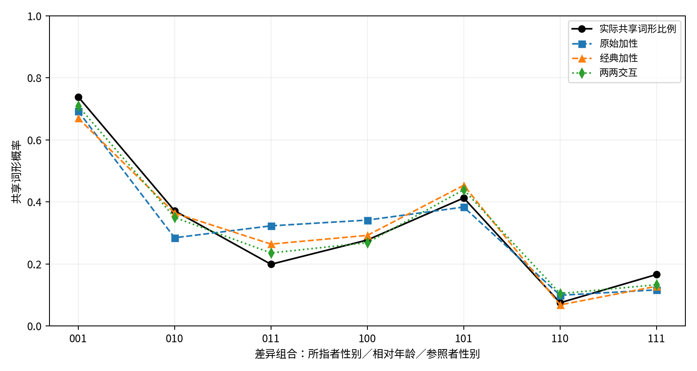

**摘要：** 英语brother/sister只区分所指者性别，日语和汉语还区分长幼，许多南岛语言则依据说话者与兄弟姐妹是否同性来命名。本文以Kinbank中939个语言系统的26,292对兄弟姐妹类别为样本，检验两个类别共用词形的概率能否由所指者性别、相对年龄和参照者性别三项差异的加性效应预测。按语系整组留出的预设比较中，两两交互模型的损失仅略低于加性模型，谱系重采样区间包含零。传统的“同性／异性”特征在代数上等于两项性别差异的交互，其预测作用集中在南岛语系。补充分析显示，约四成系统的词形共用不能由三项差异刻画，常见“只在年长者中区分性别”等次级区分；为具体类别对单设参数的模型增益更大。精确同形测量还会把西班牙语、法语的描述性记录归入区分长幼的类型。

**关键词：** 亲属称谓；兄弟姐妹；语义特征；相对性别；跨语言比较；Kinbank

## 一、引言

学习外语的人很早就会遇到兄弟姐妹称谓的差异。英语、德语、俄语用brother/Bruder/брат和sister/Schwester/сестра区分所指者性别；日语的ani、otōto、ane、imōto和汉语的“哥哥、弟弟、姐姐、妹妹”还区分长幼。因此，英译汉时常常要补出原文没有说明的年龄信息。许多南岛语言则采用第三个维度：说话者与所指者同性还是异性。语言学文献常把这类差异概括为若干语义特征的组合（Kroeber 1909；Kronenfeld 1974）。

本文讨论一个可以用数据检验的问题。兄弟姐妹的八个基本类别由三个二元维度组成：参照者（说话者）性别、所指者性别、相对年龄。两个类别之间有三项可能的差异。那么，两个类别在一种语言中共用同一词形的概率，是三项差异各自作用的简单叠加，还是取决于差异之间的组合？如果“性别不同”在年龄相同和年龄不同时的作用相同，加性模型就足够；否则需要交互。

这个问题有两个难点。第一，交互依赖于选用哪些特征。传统的“同性／异性兄弟姐妹”可以写成所指者性别差异与参照者性别差异的“异或”，所以同一种规律在一种编码中表现为主效应，在另一种编码中表现为交互。第二，同一语言的28对类别彼此相关，同一语系的语言又共享历史，评估必须检验模型能否推广到未见过的语系。

本文据此比较三个基准：原始三差异的加性模型、加入传统相对性别的加性模型和完整两两交互模型。研究问题是：（1）交互相对原始加性能带来多少跨语系预测增益；（2）传统相对性别能解释其中多少；（3）这些结论在词形定义、资料来源和估计设定改变后是否稳定。为回应估计设定问题，本文另做了一项先写定协议、后运行的补充分析。

## 二、文献回顾

### （一）成分分析与兄弟姐妹类型学

Kroeber（1909）把亲属称谓体系看作对关系的分类，并提出了一组区分维度。成分分析随后试图用属性组合刻画称谓的意义。Goodenough（1956: 211–213）指出，同一套亲属用法可以由不同的概念模型描述；Lounsbury（1956: 161–162）区分了有独立语音表达的语义成分和只能从分布中推出的成分。这两项研究说明，数据中观察到的词形分布不能唯一决定特征表述。

兄弟姐妹类型学讨论得最为具体。Kronenfeld（1974: 490–491）转述并修订了Nerlove与Romney的分析：三个二元变量产生八种亲属类型，此外还有一个由“说话者性别与所指者性别是否相同”定义的相对性别特征；特征可以作为一级、二级或三级区分出现，二级区分的位置也有倾向，例如性别作为年龄之下的二级区分时，出现在年长者一侧。Kronenfeld（1974: 501）还用Fanti的材料说明，词项覆盖可以重叠，合取定义与无重叠划分不是同一要求。Hage（1997；2001）把特征中和、标记关系和历史演变联系起来。Faris（1969: 483–484）报告，东南努巴山区的同性／异性区分只出现在男性说话者一侧，是说话者性别之下的二级成分；他把表面上的析取类别重新分析为具有层级相关意义的多义类别。这些研究提出了明确的结构假设，但没有在大规模样本上比较加性与交互的预测力。

### （二）跨语言数据库与谱系依赖

Kinbank汇集了全球一千余种语言的亲属称谓（Passmore et al. 2023），使大样本检验成为可能。基于这类数据，Jordan（2011）重建了南岛语系相对年龄与相对性别区分的历史，Passmore & Jordan（2020）发现亲属称谓在南岛、班图和犹他–阿兹特克语系中随谱系纵向传承，没有普遍的演化模式，Rácz et al.（2020）以社会实践和共享历史解释堂表亲称谓的复杂度，Pericliev（2017）则表明亲属称谓模式带有语系信息。Passmore et al.（2021）把类别之间的词形共用组织为体系内部的“共选”结构，与本文同样以类别对为分析单位。谱系依赖意味着随机拆分样本会高估推广能力，类型学研究应在模型或验证设计中处理谱系与地域依赖（Jaeger et al. 2011；Roberts et al. 2017）。

### （三）交际效率与学习研究

Kemp & Regier（2012）把亲属分类解释为简洁性与信息性的权衡，Kemp et al.（2018）将这一框架推广到多个语义域。Hallam et al.（2025a）用加权共享特征描述亲属类别的相似性，并讨论了条件性区分；Hallam et al.（2025b）在731种语言及人工推广实验中考察亲属区域之间的预测结构。Kemp（2026）讨论范畴系统的对称性，并把相对性别纳入兄弟姐妹空间。Mollica & Piantadosi（2022）则用逻辑表达式研究亲属词的学习。可见，特征组合并非新问题；本文的工作是在明确的统计尺度上量化交互增益，并检验它在传统相对性别之后还剩多少。

## 三、数据与方法

### （一）数据与样本

数据取自Kinbank仓库的锁定版本（commit `925cc0e`），谱系分类取自Glottolog 5.3的CLDF版本（commit `072ca0d`；Hammarström et al. 2026；Forkel et al. 2018），下载与分析日期为2026年10月14日。八个目标类别记为meB、myB、meZ、myZ、feB、fyB、feZ、fyZ：首字母m/f为参照者男／女，e/y为所指者年长／年幼，B/Z为所指者男／女。

该版本有218,412条词形记录，目标类别有12,537条，涉及1,208个资料编号。同一Glottocode有多份资料时，选取覆盖类别最多的一份，得到1,110个记录系统，其中941个八类齐全。剔除一个未分类和一个无法匹配谱系的系统后，主样本为939个系统、125个谱系组（语系或孤立语言）和26,292个无序类别对。样本包括方言和历史语言，下文所说的“语言”指数据库中的记录系统。

### （二）共享词形

每个类别的词形经Unicode NFC规范化并合并空白后构成集合，大小写、声调和附加符号均保留，不做人工语义判断或音系匹配。主结果为两个类别的词形集合有交集，记为“共享词形”。由于同义词集合的重叠关系不满足传递性，本文另设两种严格定义：词形集合完全相同；只保留每类恰有一个词形的系统。

### （三）差异编码与三个模型

对任一类别对，令 *D*~r~、*D*~a~、*D*~e~ 分别表示所指者性别、相对年龄、参照者性别是否不同（0或1），*η* 为共享概率的logit：

::: {custom-style="Equation"}
*M*~0~：*η* = *β*~0~ + *β*~r~*D*~r~ + *β*~a~*D*~a~ + *β*~e~*D*~e~
:::

::: {custom-style="Equation"}
*M*~1~：*η* = *β*~0~ + *β*~r~*D*~r~ + *β*~a~*D*~a~ + *β*~e~*D*~e~ + *θD*~q~
:::

::: {custom-style="Equation"}
*M*~2~：*η* = *β*~0~ + *β*~r~*D*~r~ + *β*~a~*D*~a~ + *β*~e~*D*~e~ + *γ*~ra~*D*~r~*D*~a~ + *γ*~re~*D*~r~*D*~e~ + *γ*~ae~*D*~a~*D*~e~
:::

::: {custom-style="Equation"}
*D*~q~ = *D*~r~ ⊕ *D*~e~ = *D*~r~ + *D*~e~ − 2*D*~r~*D*~e~
:::

*D*~q~ 表示两个类别在“同性／异性兄弟姐妹”上是否不同。上式说明，加入相对性别主效应与加入 *D*~r~*D*~e~ 交互得到相同的函数空间。28对类别只产生七种非零差异组合（000不存在），每种在每个系统中恰有四对。三模型的秩依次为4、5、7，*M*~2~ 对七种差异组合已经饱和，三阶交互无法再单独识别。需要强调的是，*M*~2~ 只对七个差异单元饱和：同一单元内的四对类别（例如年长兄与年长姐、年幼兄与年幼姐）必须得到相同预测。

### （四）估计与评价

分析协议在生成共享结果和拟合模型之前写定（2026年10月14日17:51 UTC），无惩罚敏感性在17:52补充，均未在外部平台注册。模型为固定效应L2岭logistic回归，主设定惩罚参数 *C*=1，截距不惩罚，每个训练语言的权重之和为1。主验证按语系整组五折留出，同一谱系组只出现在一个测试折。主指标为语言等权的对数损失，增益定义为基准损失减去比较模型损失，正值表示比较模型更好。区间由固定的折外预测按谱系组整组重抽样5,000次得到（种子20261014），反映谱系组成变化带来的不确定性，不包括重新训练和重新划折的不确定性（关于整群重抽样，参见Cameron et al. 2008）。预设的敏感性分析包括至少75%覆盖、两种严格词形定义、单一文献来源、*C*=0.1、*C*=10 和无惩罚估计。

由于冻结结果依赖 *C*，本文另写补充协议S1，提交到版本库后才运行。S1在每个外层训练集内部按语系五折选择 *C*（网格0.01至1000），比较相对性别的两种编码（*D*~q~ 与 *D*~r~*D*~e~），并加入为28种类别对各设一个参数的饱和模型 *M*~3~，以衡量七个差异单元之外的类别层面结构。S1写于主结果已知之后，只作补充分析。

## 四、结果

### （一）论坛六语种在全样本中的位置

表1列出六个论坛语种和汉语普通话的记录。七个系统的参照者性别都不影响词形，表中只列男性参照者一栏，女性参照者的记录与之相同。

**表1　论坛六语种与普通话的兄弟姐妹记录（Kinbank原始Form）**

| 语言 | 年长兄 | 年幼兄 | 年长姐 | 年幼姐 |
|--------|--------------|--------------|--------------|--------------|
| 英语 | ˈbɹʌðə | ˈbɹʌðə | sĭs'tər | sĭs'tər |
| 德语 | bʀuːdɐ | bʀuːdɐ | ˈʃvɛstɐ | ˈʃvɛstɐ |
| 俄语 | брат | брат | сестра | сестра |
| 日语 | ani | otōto | ane | imōto |
| 普通话 | ge ge | di di | jie jie | mei mei |
| 法语 | ainé | frère | ainée | soeur |
| 西班牙语 | hermano mayor | hermano menor | hermana mayor | hermana menor |

按精确同形，英、德、俄属于“只区分所指者性别”型，日语、普通话以及法语、西班牙语属于“区分性别与长幼”型。法语和西班牙语的归类来自记录方式：法语的年长项记为ainé/ainée（来源注释为first born son/daughter），西班牙语记为hermano mayor等描述性短语，而两种语言的基本词frère/soeur与hermano/hermana本身并不区分长幼。数据库另在较粗的类别下记录了这些基本词，但它们不在本文的八类之内。主样本9,830个词形中有960个含空格，分布在179个系统中，其中也包括普通话ge ge这类叠音拼写。

从全样本看，这些语言只代表少数类型（表2）。共享方式完全由三项差异决定的系统有557个（59.3%）；其余40.7%的系统在同一差异单元内部的四对类别上结果不同。

**表2　共享方式完全由三项差异决定的主要类型（N=939）**

| 类型 | 系统数 | 比例 |
|----------------------------------------|---------:|---------:|
| 区分所指者性别与长幼（日语、普通话型） | 222 | 23.6% |
| 只区分长幼 | 115 | 12.2% |
| 只区分所指者性别（英语型） | 91 | 9.7% |
| 不作区分（一个词形覆盖八类） | 60 | 6.4% |
| 只区分同性／异性 | 48 | 5.1% |
| 八类各不相同 | 4 | 0.4% |

不能由三项差异决定的系统中，有两类模式对应经典文献所说的二级区分：84个系统只在年长者中区分性别，反向的“只在年幼者中区分性别”只有12个；24个系统只在兄弟中区分长幼，“只在姐妹中区分长幼”只有9个。两种不对称的方向都与Kronenfeld（1974: 491）所述的Nerlove–Romney假设一致。这些数字未做谱系控制，例如前一类中有33个系统属于帕马–恩永甘语系，只作描述。

### （二）七种差异组合

主样本的共享词形比例为32.0%。图1按七种差异组合列出实测比例与三模型的全样本拟合值（每种组合3,756对）。只有参照者性别不同（001）时，共享率最高，为73.9%；所指者性别和年龄都不同而参照者性别相同（110）时最低，为7.5%。比较100与101最能说明相对性别的作用：只改变所指者性别时相对性别也改变，共享率为27.7%；同时改变所指者性别与参照者性别时相对性别不变，共享率反而升至41.3%。

{width=95%}

### （三）跨语系预测比较

表3给出未见语系上的预测表现。在预设的 *C*=1 下，三模型的对数损失依次下降：交互相对原始加性的增益为0.004423（约为原始损失的0.76%），95%区间为[−0.000510, 0.008205]；相对经典加性的剩余增益为0.001843，区间为[−0.000604, 0.006120]。两个区间都包含零。125个谱系组中，交互相对原始加性只在53组得分更好，72组更差。

**表3　按语系留出的语言等权对数损失**

| 模型 | 参数数 | 预设 *C*=1 | S1嵌套调参 |
|------------------------------|---------:|-------------:|-------------:|
| *M*~0~ 原始加性 | 4 | 0.581049 | 0.590703 |
| *M*~1~ 经典加性 | 5 | 0.578468 | 0.592296 |
| *M*~2~ 两两交互 | 7 | 0.576625 | 0.586649 |
| *M*~3~ 类别对饱和（S1） | 28 | 0.565972 | 0.577188 |

经典模型相对原始模型改善0.002581，约占原始到交互增益的58.3%。这一部分并不稳定：区间为[−0.004826, 0.008116]，125组中只有41组为正，移除南岛语系（296个系统）后变为−0.001536。也就是说，相对性别特征的预测价值主要来自南岛语系；Jordan（2011）也显示，相对性别区分在南岛语系内部有多种细化形式。S1还表明，同一经典模型改用乘积编码 *D*~r~*D*~e~ 后，*C*=1 下的损失高出0.000694，约为剩余增益的38%。岭惩罚下“经典与交互之差”有相当部分取决于参数化方式。

### （四）稳健性与补充分析

表4汇总预设敏感性分析和S1。至少75%覆盖和单一来源的结果与主分析接近。词形定义的影响最大：改用完全相同的词形集合或每类单一词形后，交互相对经典模型的差值变为负数，经典模型反而更好。惩罚强度也会改变结论：*C*=0.1 时交互不如原始加性，*C*=10 和无惩罚时两项增益的区间都在零以上。按语言而非语系留出时，交互相对原始加性的增益为0.009032（区间[0.001339, 0.015256]），但剩余增益0.001548的区间仍包含零。

**表4　各设定下的样本外增益（95%谱系区间）**

| 设定 | 系统数 | 交互−原始加性 | 交互−经典加性 |
|----------------|-------:|----------------------------|----------------------------|
| 主分析（*C*=1） | 939 | 0.0044 [−0.0005, 0.0082] | 0.0018 [−0.0006, 0.0061] |
| 至少75%覆盖 | 997 | 0.0048 [−0.0001, 0.0083] | 0.0023 [−0.0002, 0.0065] |
| 词形集合完全相同 | 939 | 0.0027 [−0.0020, 0.0066] | −0.0020 [−0.0052, 0.0027] |
| 每类仅一词形 | 625 | 0.0034 [−0.0025, 0.0075] | −0.0034 [−0.0066, 0.0013] |
| 单一文献来源 | 911 | 0.0043 [−0.0013, 0.0083] | 0.0013 [−0.0011, 0.0056] |
| *C*=0.1 | 939 | −0.0006 [−0.0041, 0.0045] | 0.0010 [−0.0024, 0.0055] |
| *C*=10 | 939 | 0.0100 [0.0004, 0.0173] | 0.0071 [0.0029, 0.0101] |
| 无惩罚 | 939 | 0.0104 [0.0001, 0.0182] | 0.0075 [0.0027, 0.0108] |
| S1嵌套调参 | 939 | 0.0041 [0.0012, 0.0060] | 0.0056 [0.0020, 0.0077] |

嵌套调参的结果需要结合折的构成来解读。五个外层折中，一折只含南岛语系（共享率42.3%），其余四折各含约30个语系。在后四折的训练集中，内层验证都把南岛语系单独划为一折；这四个外层折都选中了较强的惩罚（*M*~0~ 至 *M*~2~ 为 *C*=0.1），各模型的绝对损失都高于固定 *C*=1（表3）。嵌套调参下两项增益的区间虽然都不含零，但我们推断惩罚选择主要受这一大型语系影响，因此不把它看作更优设定下的证据。

对类别层面结构的检验得到较一致的结果。在两种设定下，类别对饱和模型 *M*~3~ 都优于两两交互模型：*C*=1 下增益0.010654，区间[−0.003565, 0.023410]，移除南岛语系后为−0.001366；嵌套调参下增益0.009461，区间[0.006000, 0.015919]，125组中95组为正，移除南岛语系后为0.012304。两种设定下，这一增益的点估计都大于交互相对原始加性的增益。

全部135次预设折内拟合均收敛；独立核验脚本从原始词形重建了全部配对结果，复算误差不超过 2.22×10^−16^；S1在 *C*=1 下完全重现了冻结结果。

## 五、讨论

### （一）“交互”取决于特征的选择

相对性别的代数关系是本文最确定的结论。若以所指者性别和参照者性别为基本特征，同性／异性规律就表现为二者的交互；若以相对性别为基本特征，同一规律只是一个主效应。Kronenfeld（1974: 491）将相对性别定义为说话者性别与所指者性别的比较，这与 *D*~q~ = *D*~r~ ⊕ *D*~e~ 完全对应。因此，问“兄弟姐妹称谓是否存在特征交互”，必须先说明以哪组特征为基础，正如Goodenough（1956: 211–213）所说，同一用法可以对应不同的概念模型。本文的三个基准把这一点落实为可以检验的比较：先纳入传统关系特征，再测量剩余的非加性。

传统相对性别的预测作用在语系之间也很不均匀（见四（三））。论坛六语种都不区分同性／异性，对以这些语言为背景的学习者而言，这不是熟悉的维度，但它在南岛语系中具有明显的预测作用。

### （二）剩余非加性依赖测量

在传统相对性别之后，交互的剩余增益在主设定下很小，区间包含零。以词形重叠为结果时，五种估计设定下的点估计均为正（*C*=0.1、1、10、无惩罚和嵌套调参），其中三种的区间不含零；改用更严格的词形定义后，点估计转为负值。剩余非加性因此与同义词集合的处理方式密切相关。Kronenfeld（1974: 501）的芳蒂语例子可以说明原因：男性说话者的姐妹既有专称，也可用兄弟姐妹的通称，两个词项的覆盖范围重叠。按“至少共用一个词形”的定义，通称与专称并存的记录会被计为共享，而这种重叠在各差异单元中的分布不一定可加。因此，本文只能确定总体共享模式在这一定义下偏离加性，在严格定义下则没有得到支持。

### （三）类别层面的结构

S1与描述统计指向同一方向。七单元模型不论加入多少交互，都要求同一差异单元内的类别对得到相同预测，而40.7%的系统不满足这一条件。类别对饱和模型在两种设定下的点估计都高于交互模型，约为交互本身增益的两倍以上；嵌套调参下其区间不含零，*C*=1 下区间包含零，且依赖南岛语系。*M*~3~ 本身不能说明增益来自哪种结构。描述统计显示，偏离七单元结构的系统中，最常见的模式是性别只在一个年龄段中区分（96个系统），其中绝大多数只在年长者中区分，与经典文献所说的次级区分一致。Faris（1969: 483–484）报告的同性／异性区分只用于男性说话者，也属于这种条件性结构。Kronenfeld（1974: 501）关于词项重叠的讨论则提示，类别层面的结构还可能来自多义和同义记录。

方法上，把类别对的关系概括为三项差异的函数，会丢掉“区分出现在哪一侧”的信息，而这正是成分分析关注的层级结构。检验特征组合时，应在类别层面而不只在差异层面建模，例如加入条件性特征，或使用保持划分一致性的生成模型。

### （四）共享词形不等于共享语义

表1的法语和西班牙语提醒我们，数据库中的“词形”是来源文献记录的形式，不等于语言中的基本词汇单位。西班牙语hermano mayor与hermano menor共享核心词hermano，但精确同形把二者视为不同词形，使西班牙语与日语归为一类。法语记录把ainé放进“年长兄”一格，这更接近词汇选择问题，而非frère的语义区分。主样本约10%的词形含空格，说明描述性短语并非个别现象。本文采用精确同形，是为了让测量透明、可复现；但这一选择意味着本文测得的是“共用书面形式”，而非“共用语义范畴”。Kronenfeld（2006）对词干与修饰手段的讨论也表明，形态关系需要单独编码。

对外语研究而言，这一结果有两点启示。其一，翻译中brother与“哥哥／弟弟”之间的对应问题，本质上是两种语言选用了不同特征组合；全样本中“区分性别与长幼”型占23.6%，“只区分性别”型只占9.7%（未作谱系加权），英语型并非常态。其二，大规模类型学数据库能为对比语言学提供样本，但使用者需要回到原始记录，核对描述性短语和较粗类别的展开方式。

### （五）局限

本文实施的是固定效应模型，没有拟合语言或语系随机效应，也没有建模地域接触；区间以固定的折外预测为条件，不包含重训和重新划折的不确定性。样本中南岛语系占31.5%，并影响了折的构成和惩罚选择。S1写于主结果已知之后，次级区分的统计只是描述，均不能视为事前检验。总体logit的非加性也可能由语言之间的异质性混合产生，不能直接推出单个语言使用者的心理表征。

## 六、结论

本文用Kinbank中939个语言系统检验了兄弟姐妹称谓的特征组合。第一，传统相对性别等于两项性别差异的异或，所以“是否存在交互”取决于特征的选择。第二，在预设的跨语系比较中，两两交互只带来小幅改进，区间包含零；相对性别的作用主要来自南岛语系，传统特征之后的剩余增益随词形定义和惩罚设定改变方向。第三，为具体类别对单设参数的模型比两两交互有更大的增益点估计；约四成系统不能由三项差异完全刻画，其中常见的次级区分方向与经典的Nerlove–Romney假设一致。第四，西班牙语和法语等论坛语种的记录表明，精确同形测得的是共用书面形式，与语义范畴之间仍有距离。今后的研究可以在类别层面建立条件性特征模型，并结合原始文献和语言内部的形态信息改进测量。

## 数据与代码

数据来自Kinbank与Glottolog CLDF的锁定版本。冻结协议、分析脚本、全部敏感性结果、补充协议S1（git提交 `3dba6e0`，早于S1运行）及其输出、本文表1和表2的描述脚本，均公开于 https://github.com/WuYusen825/kinship-semantic-interactions。

## 参考文献

Cameron, A. C., J. B. Gelbach & D. L. Miller. 2008. Bootstrap-based improvements for inference with clustered errors [J]. *The Review of Economics and Statistics* 90(3): 414-427.

Faris, J. C. 1969. Sibling terminology and cross-sex behavior: Data from the Southeastern Nuba Mountains [J]. *American Anthropologist* 71(3): 482-488.

Forkel, R., J.-M. List, S. J. Greenhill, C. Rzymski, S. Bank, M. Cysouw, H. Hammarström, M. Haspelmath, G. A. Kaiping & R. D. Gray. 2018. Cross-Linguistic Data Formats, advancing data sharing and re-use in comparative linguistics [J]. *Scientific Data* 5: 180205.

Goodenough, W. H. 1956. Componential analysis and the study of meaning [J]. *Language* 32(1): 195-216.

Hage, P. 1997. Unthinkable categories and the fundamental laws of kinship [J]. *American Ethnologist* 24(3): 652-667.

Hage, P. 2001. Marking theory and kinship analysis: Cross-cultural and historical applications [J]. *Anthropological Theory* 1(2): 197-211.

Hallam, M., S. Kirby, F. Jordan & K. Smith. 2025a. Efficient communication drives the semantic structure of kinship terminology [A]. In *Proceedings of the Annual Meeting of the Cognitive Science Society* 47 [C]. 5831-5837.

Hallam, M., F. M. Jordan, S. Kirby & K. Smith. 2025b. Predictive structure emerges during the generalisation of kin terms to new referents [J]. *Open Mind* 9: 1431-1466.

Hammarström, H., R. Forkel, M. Haspelmath & S. Bank. 2026. *Glottolog 5.3* [DB/OL]. Leipzig: Max Planck Institute for Evolutionary Anthropology. https://glottolog.org.

Jaeger, T. F., P. Graff, W. Croft & D. Pontillo. 2011. Mixed effect models for genetic and areal dependencies in linguistic typology [J]. *Linguistic Typology* 15(2): 281-320.

Jordan, F. M. 2011. A phylogenetic analysis of the evolution of Austronesian sibling terminologies [J]. *Human Biology* 83(2): 297-321.

Kemp, C. 2026. Symmetry in category systems across languages [J]. *Nature Communications* 17: 358.

Kemp, C. & T. Regier. 2012. Kinship categories across languages reflect general communicative principles [J]. *Science* 336(6084): 1049-1054.

Kemp, C., Y. Xu & T. Regier. 2018. Semantic typology and efficient communication [J]. *Annual Review of Linguistics* 4: 109-128.

Kroeber, A. L. 1909. Classificatory systems of relationship [J]. *The Journal of the Royal Anthropological Institute of Great Britain and Ireland* 39: 77-84.

Kronenfeld, D. B. 1974. Sibling typology: Beyond Nerlove and Romney [J]. *American Ethnologist* 1(3): 489-506.

Kronenfeld, D. B. 2006. Issues in the classification of kinship terminologies: Toward a new typology [J]. *Anthropos* 101(1): 203-219.

Lounsbury, F. G. 1956. A semantic analysis of the Pawnee kinship usage [J]. *Language* 32(1): 158-194.

Mollica, F. & S. T. Piantadosi. 2022. Logical word learning: The case of kinship [J]. *Psychonomic Bulletin & Review* 29(3): 766-799.

Passmore, S., W. Barth, S. J. Greenhill, K. Quinn, C. Sheard, P. Argyriou, J. Birchall, C. Bowern, J. Calladine, A. Deb, A. Diederen, N. P. Metsäranta, L. H. Araujo, R. Schembri, J. Hickey-Hall, T. Honkola, A. Mitchell, L. Poole, P. M. Rácz, S. G. Roberts, R. M. Ross, E. Thomas-Colquhoun, N. Evans & F. M. Jordan. 2023. Kinbank: A global database of kinship terminology [J]. *PLOS ONE* 18(5): e0283218.

Passmore, S., W. Barth, K. Quinn, S. J. Greenhill, N. Evans & F. M. Jordan. 2021. Kin against kin: Internal co-selection and the coherence of kinship typologies [J]. *Biological Theory* 16(3): 176-193.

Passmore, S. & F. M. Jordan. 2020. No universals in the cultural evolution of kinship terminology [J]. *Evolutionary Human Sciences* 2: e42.

Pericliev, V. 2017. Kin term patterns and language families [J]. *Cognitive Studies | Études cognitives* 17: 1374.

Rácz, P., S. Passmore & F. M. Jordan. 2020. Social practice and shared history, not social scale, structure cross-cultural complexity in kinship systems [J]. *Topics in Cognitive Science* 12(2): 744-765.

Roberts, D. R., V. Bahn, S. Ciuti, M. S. Boyce, J. Elith, G. Guillera-Arroita, S. Hauenstein, J. J. Lahoz-Monfort, B. Schröder, W. Thuiller, D. I. Warton, B. A. Wintle, F. Hartig & C. F. Dormann. 2017. Cross-validation strategies for data with temporal, spatial, hierarchical, or phylogenetic structure [J]. *Ecography* 40(8): 913-929.
