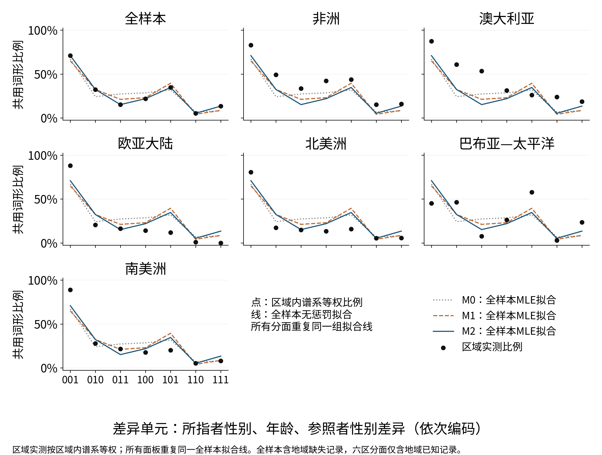
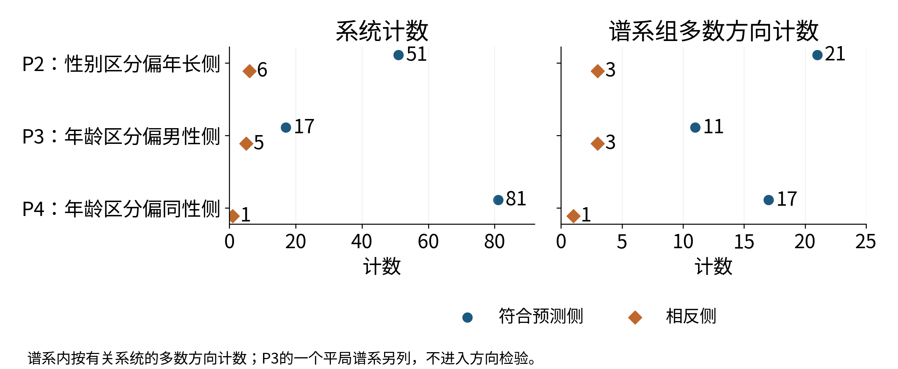

**摘要：** 兄弟姐妹称谓如何组合性别、年龄和说话者信息，是亲属语义学的经典问题。本文分析Kinbank中939个记录系统，在事后补充协议下，以严格划分检验合取及层级约束，并比较未见谱系与地域的词形共用预测。625个单词形系统中，非合取记录占3.5%，远低于两种人工随机参照；性别偏年长侧、年龄偏同性侧获得谱系方向支持，年龄偏男性侧未获支持。条件模型相对原始加性的对数损失降低0.0145，但相对完整差异交互的增益区间跨零，且跨地域不占优势。参照者性别限制出现少数记录不兼容，真实语义解释仍未确认。结果提示经典约束获得部分支持，其适用范围取决于表示、测量和推广目标。

**关键词：** 亲属称谓；兄弟姐妹；合取；层级区分；共词化；跨语言比较

## 一、引言

英语brother与sister、德语Bruder与Schwester、俄语брат与сестра区分所指者性别，日语ani、otōto、ane、imōto和汉语“哥哥、弟弟、姐姐、妹妹”还区分长幼。有些语言进一步考虑说话者与兄弟姐妹是否同性。这样的差异使翻译不只是更换标签，还须选择原语未明示的关系信息。性别、代际、长幼等维度早已进入亲属分类研究（Kroeber, 1909）；问题在于，词汇怎样把这些维度组织成类别。

知道一个体系使用性别和年龄，尚不能确定二者的作用范围。性别可能区分所有兄弟姐妹，也可能只区分年长者；年龄可能只在同性兄弟姐妹中起作用。经典类型学因而提出了超出特征清单的结构要求：词项能否由特征值的合取定义，区分是否沿层级展开，次级区分通常出现在哪一侧（Kronenfeld, 1974）^490-491^。另一些理论则从约束排序或亲属术语的生成运算解释体系组织（Jones, 2010；Read, 2007）。这些表示并不等价，需要明确观察对象以后比较。

大规模数据库提供了检验条件，也带来新的界限。数据库中的词形记录受来源影响，术语分类模式又带有谱系结构（Passmore et al., 2023；Pericliev, 2017）。共享词形、词形相似和同一语义范畴之间不能直接画等号；同一语言内多对关系及同源语言也不能当作独立重复。与此同时，合取性是词项外延的性质，加性是指定概率尺度上的限制，二者可以共存，不构成穷尽的二选一。

本文据此检验：兄弟姐妹的合取和层级约束在何种范围成立，保留次级区分位置是否提高对未见谱系和地域的词形共用预测？研究分别考察严格划分的结构、类别对的概率及测量边界。贡献在于把经典方向假设转成可复查的操作定义，并在统一资料和验证目标下比较表示，而不把相对性别的定义或条件区分本身当作新发现。

## 二、文献综述

### （一）合取、层级与不对称

特征基底必须先于结构判断。相同亲属用法可以有不同概念方案（Goodenough, 1956）^211-213^；与之相应，语义成分没有独立语音形式，也不意味着该对立不存在（Lounsbury, 1956）^161-162^。经典兄弟姐妹分析在固定基底上区分一级、二级和三级作用域，并对二级位置提出方向性要求（Kronenfeld, 1974）^491^。但Fanti的合取词项可以重叠，Nuba材料又涉及男性说话者侧的条件区分及多义重分析，合取不能直接等同于无重叠划分（Kronenfeld, 1974）^501^（Faris, 1969）^483-484^。标记理论进一步联系结构与历史，同时承认年龄标记并非文化上恒定（Hage, 1997）^662-663^（Hage, 2001）^204-205^。因此，类别形状、层级位置和方向须分开检验。原假设与其修订也须区分：Kronenfeld后来主张参照者性别可由其他关系特征替代，这同“只作三级区分”并非同一命题（Kronenfeld, 1974）^498-499^。一条记录可兼容多种分解，验证某个表示存在，不能推成所有分析都唯一服从它。

### （二）谱系差异与结构尺度

历史比较提高了普遍化要求。南岛语研究分别追踪年龄和相对性别的历史，把二者是否共同变化留作后续问题（Jordan, 2011）^302,315-316^；跨三个语系的分析则未支持单一普遍演化路径（Passmore & Jordan, 2020）^3-5^。堂表亲类型复杂度与社会实践及共享历史相关，而班图类型同社会组织共同演化的证据有限，说明不同范围的结论不能互相替代（Rácz et al., 2020，Early View）^7-11^（Guillon & Mace, 2016）^1^。体系内部也不总是协调：跨代共选分析发现大量混合类型，后续条件熵研究则用不同指标发现731个体系中的预测结构（Passmore et al., 2021）^182-184^（Hallam et al., 2025b）^1435-1438^。局部条件规律能否跨谱系和地域成立，仍须在明确尺度上检验。共选研究还以连续词形距离构造体系空间，不能直接等同于类别对是否共享形式（Passmore et al., 2021）^187-188^。两代类型是否一致、名称能否相互预测和局部区分是否合乎方向，是相关但可给出不同答案的对象。

### （三）表示选择与效率解释

效率研究并不共同预设纯合取。规则长度模型允许合取与析取，合取优势由简洁性—信息量权衡产生；综述也容许多种成本代理（Kemp & Regier, 2012）^1050,1053^（Kemp et al., 2018，作者稿）^4,7^。一般概念模型组合对象、特征和关系（Kemp, 2012），亲属学习模型进一步包含集合并、交、差与补等操作（Mollica & Piantadosi, 2022）^771-772^。与之不同，六特征加权和拟合语义相似度同词形编辑相似度的相关，但作者已讨论Navajo的条件区分，并在权重回归中处理语系依赖（Hallam et al., 2025a）^5833-5836^。对称性研究也已纳入相对性别、重叠类别和谱系回归，其1172个兄弟姐妹系统的主要结果是类别数奇偶（Kemp, 2026）^5,8^。需要比较的是具体表示的预测，不是把先行理论说成忽视条件或历史。权重的跨语言排序也不同于单个体系内的一级、二级作用域。学习研究区分学习中的简洁性偏好与交际中的信息压力，领域通用偏好则可因表示不同而产生不同结构（Carr et al., 2020，作者稿）^1-3^（Culbertson & Kirby, 2016）。这些分歧使明确对照比给整个传统贴“加性”标签更有解释力。

### （四）共词化与范畴测量

同一形式是语义组织的线索，而非范畴同一的充分证据。严格共词化须同派生、复合等宽松联系区分，数据库的规范化又会改变相同判定（François, 2008）^170-172^（Rzymski et al., 2020）^4-5^；亲属词的修饰手段同样需要单独处理（Kronenfeld, 2006）^216^。情绪网络显示共享结构与文化地域差异并存，概念关联研究则区分联想和相似度的贡献（Jackson et al., 2019，正文页）^2-4^（Xu et al., 2020，作者稿）^9-12^。交流实验进一步表明，相似意义是否合并受区分需要调节；非线性研究据此修正简单单调预测，并已加入谱系和地理指标（Karjus et al., 2021）^19-23^（Brochhagen & Boleda, 2022，作者稿）^6-8,11^。这种观测关系还可能因同义词而重叠：两个类别有词形交集，不保证它们与第三类的共享具有传递性。因而，局部共词化边不能自动转为整套等价划分。由此，本文把经典结构约束、群组外推和多种同形定义汇入同一设计，同时保留各自的估计对象。

## 三、数据与方法

### （一）资料、单位与词形定义

数据沿用Kinbank的锁定版本`925cc0e`及Glottolog CLDF分类`072ca0d`，保留语言、关系类别、词形和来源之间的关联（Passmore et al., 2023；Forkel et al., 2018）。八类由参照者性别s、相对年龄a、所指者性别r组成，分别记作meB、myB、meZ、myZ、feB、fyB、feZ、fyZ。主样本为939个八类齐全的记录系统、125个谱系组和26,292个无序类别对；同一Glottocode保留覆盖最多的一份资料。下文“系统”包括方言及历史语言，不等于相互独立的当代语言。

形式仅作Unicode NFC和空白规范化，保留大小写、声调和附加符号，不新增语义标注。D1为两类别至少共用一个形式；D2要求词形集合完全相同；D3限每类单一词形的系统，此时形成严格划分；D4从D1排除含空格形式的系统；D5按空白切分后共用任一词元，仅作机械敏感性。D4不把空格当作已经证实的词界，D5另报叠音等受影响形式。形式长度和意义区分已有联合效率建模（Mollica et al., 2021），本文将完整同形作为独立观测量。宏观区域取原记录首个标签，多值和缺失另列。

### （二）结构约束与方向假设

主结构定义为词项外延恰等于若干特征取值的交集；另检验整套划分能否由逐特征二分、每词项恰占一叶的树表示。主基底含s、a、r及相对性别q=s⊕r；扩展加入互动中年长者与年幼者的性别。八元集合的4140个划分经精确枚举。主基底有260个合取划分，单叶树有236个；扩展后分别为518与434。它们不能逐格复现Kronenfeld的236与442，故保持算法定义，并在补充材料公开差异（Kronenfeld, 1974）^502-503^。

P1比较D3中非合取比例与两种精确参照：所有划分等概率；保持该系统块大小的划分等概率。主定义须对两种参照的“观测−参照”区间上界均低于零，才记方向支持。P2—P4依次预测性别区分偏年长侧、年龄区分偏男性侧与同性侧；判定除同侧最小对外，还要求父根、目标子根及两侧递归结构均有合法树见证，代理计数另报。P5搜索合法四特征树，判断是否存在省略s或仅在三级及以下使用s的表示；无合法树者列为域外，不计独立P5违例。存在兼容树只说明结构可兼容。此检验针对491页总结的限制，与作者后来认为参照者性别可省略的修订分开（Kronenfeld, 1974）^491,498-499^。

P2—P4按谱系内多数方向投票，平局不进检验分母，作单侧精确二项检验并作三项Bonferroni调整；系统、区域和去除两大型谱系的结果并报。违例按Glottocode顺序抽查前20个不同系统的Value、Form、Comment和Source；区分字段可支持的解释与无法判断，不把自动结构违例当作已确认的语言语义反例。

### （三）类别对模型与外推

二元共享采用logit模型，所有“加性”和“交互”均限此尺度（Jaeger, 2008）。令Dr、Da、De分别为三特征差异，Dq=Dr+De−2DrDe是编码恒等式。五模型见表1；M2对七个非零差异单元饱和，M3才对28种具体类别对饱和。M4保留端点状态：E、B、S、M分别表示两端均年长、所指者均男性、均同性关系、参照者均男性，差异非零时相应共同状态为零。

**表1　模型表示及可识别维度**

| 模型 | 设计 | 秩 |
|---|---|---:|
| M0 | 截距、Dr、Da、De | 4 |
| M1 | M0＋Dq | 5 |
| M2 | M0＋DrDa、DrDe、DaDe | 7 |
| M3 | 28类具体类别对指示变量 | 28 |
| M4 | M2＋E、B、S、M＋DrE、DaB、DaS | 14 |

主估计为无惩罚最大似然，训练和评分均按谱系组等权；语言等权及C=1岭估计完整并报，两种训练总权重均保持系统数。每折检查秩、分离与收敛；必要时采用Firth型校正并记录触发，非整数权重下不直接沿用独立整数观测的偏差性质（Firth, 1993）。主验证沿用语系整组五折，另作留一宏观区域和语言五折，D3、D4保持原折号。阻断方式对应不同外推目标，不能互作替代（Roberts et al., 2017）^913-917^。

主指标为折外对数损失，增益为基准减去比较模型损失。固定预测按谱系整组自助5000次形成百分位95%区间，保留组内关系；它不同于包含重新训练的区间，也不借用聚类线性模型的bootstrap-t性质（Cameron et al., 2008）^416^。M4三条件系数另作5000次整谱系重拟合，辅报多重调整区间。五种测量×两估计×两权重的全部20条件均运行三种验证。P6须主语系留出中M4相对M0、M2均有正增益区间，且三条件系数95%区间均为负，才能整体记支持；地域推广独立判断。M4不强制合取、传递性或层级，不能以预测增益替代P1—P5。

### （四）分析地位与推断范围

冻结分析及S1保留原设定。S2协议在二者及评审核查结果已知后单独提交，属于事后补充，非预注册。主估计改为MLE、主权重改为谱系等权时，旧无惩罚结果较好及谱系加权增益较大已经知晓；改变同时针对C=1强收缩及大型谱系权重问题，不包装为与结果无关的决定。另以语系和宏观区域交叉随机截距的变分贝叶斯模型作未加权敏感性；该近似不替代主加权或解决全部语言内相关。全文以实际执行的S2结果界定结构与预测的适用范围。

## 四、结果

### （一）合取偏好及表示边界

严格划分样本含625个系统、108个谱系组。四特征下22个系统不合取，占3.5%；谱系等权比例为2.8%，谱系整组自助95%区间为[0.5%, 6.0%]。两种人工参照的非合取率分别为93.7%和82.9%；“观测−参照”分别为−90.9个百分点[−93.2, −87.8]和−80.1个百分点[−83.3, −76.4]，均低于零，P1按运行前规则获得方向支持。其含义是记录中的合取结构较随机划分集中，不是随机划分已成为语言演化模型。

表示选择会明显改变可描述范围：只用s、a、r时非合取系统为163个，加入传统q后降为22个。四特征任意合取与递归树在本样本均有22个不兼容系统，扩展六特征后均为21个。观测样本因而没有区分两种定义，但它们在全部理论划分上的允许集合不同，不能由观测相同宣称两定义等价。去除南岛或帕马–恩永甘后，P1相对两种参照的差值方向保持。

### （二）次级位置只获部分支持

严格结构见证区分了几条经典预测（表2、图2）。性别二级区分偏年长侧、年龄二级区分偏同性侧，在谱系多数投票及多重调整后仍获方向支持；年龄偏男性侧仅有同向点估计，调整后未得到支持。三项都不能由系统数之比直接替代谱系检验。P3另有一个谱系组平局，不进入其二项分母；不适用的系统也不是反向证据。

**表2　严格二级区分的方向比较**

| 预测 | 系统：预测/反向 | 谱系：预测/反向 | 单侧p | 调整p | 判定 |
|---|---:|---:|---:|---:|---|
| P2 性别偏年长侧 | 51/6 | 21/3 | 0.0001 | 0.0004 | 方向支持 |
| P3 年龄偏男性侧 | 17/5 | 11/3 | 0.0287 | 0.0861 | 未支持 |
| P4 年龄偏同性侧 | 81/1 | 17/1 | <0.0001 | 0.0002 | 方向支持 |

去除两个大型谱系的指定检查中，P2、P4仍获方向支持，P3仍未支持；区域方向却不完全一致。P5有600个系统存在兼容树，22个无合法单叶树而列域外，另3个记录系统在全部合法树中都需较早使用s：Umbundu、Urak Lawoi与Yuracare。这只与所定数据库普遍版本不兼容；其词项分析是否为真实语义反例仍未确认。固定顺序抽查20个不同违例系统，全部保留可核对形式和来源，语义解释仍未决；其中4个有含空格形式，1个有较粗兄弟姐妹记录可作背景，不能据此把违例全部归因于资料错误。运行后另补查全部22个主四特征非合取系统及3个P5不兼容系统，共25个；连同固定样本，去重后审查43个系统。补查保留为事后质量核查，真实语义解释仍未确认，不替代预定抽查。

### （三）条件表示相对不同基准的增益

主设定的损失见表3。M4相对M0改善0.0145，谱系整组自助95%区间为[0.0076, 0.0219]；相对M2只改善0.0018，[−0.0005, 0.0039]包含零，125组中51组改善、74组变差。换算到完整系统的28对，平均对数似然比分别为0.4055和0.0491，其区间分别为[0.2115, 0.6134]和[−0.0154, 0.1106]。额外位置编码相对已有差异交互的增益尚不稳定。

**表3　主设定各模型折外对数损失**

| 模型 | 未见谱系（939系统） | 未见区域（909系统） |
|---|---:|---:|
| M0 | 0.5088 | 0.5326 |
| M1 | 0.5020 | 0.5410 |
| M2 | 0.4961 | 0.5400 |
| M3 | 0.4944 | 0.5407 |
| M4 | 0.4943 | 0.5405 |

{width=95%}

{width=95%}

三个理论系数的5000次整谱系重拟合均成功，但方向证据有别（表4）。年长条件下性别差异和同性条件下年龄差异的区间均为负，男性条件下年龄差异则跨零；多重调整区间维持这一判断。它们描述控制其他设计列后的总体logit对照，不是表2语言内部树方向的同一种统计量。因M2到M4的增益及一个指定系数均不满足规则，P6整体未得到支持。

**表4　M4理论条件项与谱系重拟合95%区间**

| 条件项 | 系数 | 区间 |
|---|---:|---|
| DrE：性别×均年长 | −0.4578 | [−0.7822, −0.1648] |
| DaB：年龄×均男性 | −0.1195 | [−0.3801, 0.1305] |
| DaS：年龄×均同性 | −0.6558 | [−1.0488, −0.3197] |

### （四）地域、测量与估计的边界

未见区域上的表现不同：排除30个缺地域系统后，M4相对M0的增益为−0.0079，[−0.0143, −0.0014]；相对M2为−0.0005，[−0.0031, 0.0021]。因此，语系留出的改善不能推广为跨地域优势。移除大型谱系而不重训的杠杆检查亦不能替代重新评估地区分布。

估计设定同样改变结论。原C=1、语言等权下，M2相对M0增益0.0044，[−0.0005, 0.0082]，相对M1为0.0018，[−0.0006, 0.0061]。该收缩使七单元饱和模型的全样本拟合偏离实测率最多3.7个百分点。改用MLE、谱系等权及语系验证后，D1—D5中M2相对M1的区间均为正，M4相对M2却均跨零。故严格测量没有在当前主估计下消除传统相对性别以外的差异非加性，也没有确立条件位置的额外优势。完整交叉结果在补充材料逐项报告。

D5改变141个系统的1573对结果；相邻重复词元所在线索系统未改变共享结果，说明切词影响不应概括成叠音效应。缺地域的30个系统保留于谱系分析而排除于区域验证及混合模型。三种交叉随机截距模型在预定重试后均因精度损失未满足收敛判据，其近似结果仅作诊断，不提供稳定的层级模型推断。

## 五、讨论

### （一）合取偏好有范围，层级约束有分化

结果提示，真实记录在合取划分中高度集中，但经典约束并非整套获得支持。P1相对人工参照的差距很大，P2和P4在谱系单位上保留预期方向，P3却未通过指定调整。由此更合适的结论是部分结构约束具有跨谱系集中性，而不是一项普遍层级法则解释所有体系。尤其年龄在男性侧与同性侧的预测不能混为一条“男性优先”规律，相对性别改变了作用对象。

这一分化与经典理论内部的分歧相联系。Kronenfeld将两项侧向假设概括为未标记侧约束，并把男性和年长项视为未标记；Hage则指出年龄标记并非跨文化恒定，并记载大洋洲年幼项成为未标记项（Kronenfeld, 1974）^496^（Hage, 2001）^204-205^。本文对某方向的支持不能抹去历史和地域边界，对某方向未获支持也不能推出该语义维度毫无作用。P5更要求把“某个基底早期使用s”和“所有合法分析都无法延后s”区别开来。兼容树是存在性结果，不是认知分解的唯一证据；少数不兼容记录还需语言内部词项和用法材料才能解释。

### （二）概率增益没有直接裁决语义理论

合取集中与概率预测之间存在距离。严格划分中的一种结构可以在多个语言里反复出现，而语言混合后的总体logit关系仍可能非加性；一个概率模型也可拟合局部共享倾向，却不保证预测共同组成合法划分。本文M0、M1是logit工作似然基准，并非Hallam加权相似度算法的原样复算。M4优于M0，因而不能解释成推翻其理论，更不能在M4相对M2区间跨零时宣称条件表示全面胜出。

学习和效率研究提供可检验的解释候选，而不是由这里的观察资料直接识别的机制。颜色研究先以非均匀知觉空间解释类别，再以信息瓶颈容纳软边界（Regier et al., 2007；Zaslavsky et al., 2018）；用途资料强调交际需要，后续分析又发现知觉结构之外的交际需要迹象（Gibson et al., 2017；Zaslavsky et al., 2019）。这一对话说明，相近的类别规律可能兼容不同过程。亲属研究同样须把学习偏好、信息需求与文化历史分别测量，才能进一步解释为何出现这里的合取集中和方向分化。

### （三）测量与推广目标共同限定结论

论坛语种揭示了测量的具体含义。西班牙语hermano mayor与hermano menor完整形式不同，却共享hermano；法语ainé与frère的资料并置涉及不同层级的表达选择。D5能机械改变前者的同形关系，却不自动恢复“真正词干”，也不能解决后者的类别选词。普通话ge ge的空格属于另一种记录现象，不能与描述性短语一并删除后就宣称改进了语义效度。D1—D5让这些选择的后果可见，但没有一种定义凭自身保证等同于心理范畴。

共词化网络研究亦区分相似性、联想、语义模糊与交际区分需要（François, 2008）^170-172^（Karjus et al., 2021）^19-23^。因此，精确形式与原始来源的可追溯性是进一步研究的起点，不是词义分析的终点。抽查中保留“无法判断”尤其重要：如果把全部异常自动归成噪声，结构约束就失去可反驳性；如果直接当作确证的语义反例，又超过已有字段所能提供的证据。

推广目标也不能混淆。谱系留出允许训练和测试共享区域背景，区域留出则检验另一种分布转移。本研究在两者之间出现方向差异，提示群组验证不仅是修正标准误的技术，还定义结论适用于何种新对象。谱系整群区间保留组内关系，却没有消除区域接触；固定预测区间不含重训不确定性，GLMM未收敛也使模型化敏感性没有完成稳定估计。进一步工作需要完整系统发生与接触信息、保持划分一致性的生成模型，以及对条件位置的语言内部验证。

## 六、结论

本研究把合取、层级位置和共享概率分别操作化，所得证据支持有边界的组合约束。记录体系的合取性高于人工随机参照，性别偏年长侧与年龄偏同性侧得到方向支持，年龄偏男性侧未获调整后的支持；参照者性别的少数不兼容记录仍缺真实语义判定。显式条件模型优于原始加性，但对完整差异交互的增益不稳定，跨地域亦无优势。经典组合观因此获得部分而非整体支持，贡献在于明确哪些约束可在所定资料和外推目标下重复，哪些须由更细的测量与历史解释继续检验。

## 数据与代码

版本化原始数据、冻结分析、S1、S2运行前协议和全部结果保存于 https://github.com/WuYusen825/kinship-semantic-interactions。S2最终协议独立提交为`6ba7afba369d3d15446ea7571eabd2117b7e8c74`。开放资料沿各来源许可使用。

## 参考文献

Brochhagen, T. & G. Boleda. 2022. When do languages use the same word for different meanings? The Goldilocks principle in colexification [J]. *Cognition* 226: 105179. https://doi.org/10.1016/j.cognition.2022.105179.

Cameron, A. C., J. B. Gelbach & D. L. Miller. 2008. Bootstrap-Based Improvements for Inference with Clustered Errors [J]. *Review of Economics and Statistics* 90(3): 414-427. https://doi.org/10.1162/rest.90.3.414.

Carr, J. W., K. Smith, J. Culbertson, et al. 2020. Simplicity and informativeness in semantic category systems [J]. *Cognition* 202: 104289. https://doi.org/10.1016/j.cognition.2020.104289.

Culbertson, J. & S. Kirby. 2016. Simplicity and Specificity in Language: Domain-General Biases Have Domain-Specific Effects [J]. *Frontiers in Psychology* 6: 1964. https://doi.org/10.3389/fpsyg.2015.01964.

Faris, J. C. 1969. Sibling Terminology and Cross-Sex Behavior: Data from the Southeastern Nuba Mountains [J]. *American Anthropologist* 71(3): 482-488. https://doi.org/10.1525/aa.1969.71.3.02a00080.

Firth, D. 1993. Bias reduction of maximum likelihood estimates [J]. *Biometrika* 80(1): 27-38. https://doi.org/10.1093/biomet/80.1.27.

Forkel, R., J.-M. List, S. J. Greenhill, et al. 2018. Cross-Linguistic Data Formats, advancing data sharing and re-use in comparative linguistics [J]. *Scientific Data* 5(1): 180205. https://doi.org/10.1038/sdata.2018.205.

François, A. 2008. Semantic maps and the typology of colexification: Intertwining polysemous networks across languages [A]. In M. Vanhove (ed.). *From Polysemy to Semantic Change: Towards a Typology of Lexical Semantic Associations* [C]. Amsterdam; Philadelphia: John Benjamins. 163-215. https://doi.org/10.1075/slcs.106.09fra.

Gibson, E., R. Futrell, J. Jara-Ettinger, et al. 2017. Color naming across languages reflects color use [J]. *Proceedings of the National Academy of Sciences* 114(40): 10785-10790. https://doi.org/10.1073/pnas.1619666114.

Goodenough, W. H. 1956. Componential Analysis and the Study of Meaning [J]. *Language* 32(1): 195-216. https://doi.org/10.2307/410665.

Guillon, M. & R. Mace. 2016. A Phylogenetic Comparative Study of Bantu Kinship Terminology Finds Limited Support for Its Co-Evolution with Social Organisation [J]. *PLOS ONE* 11(3): e0147920. https://doi.org/10.1371/journal.pone.0147920.

Hage, P. 1997. Unthinkable Categories and the Fundamental Laws of Kinship [J]. *American Ethnologist* 24(3): 652-667. https://doi.org/10.1525/ae.1997.24.3.652.

Hage, P. 2001. Marking Theory and Kinship Analysis: Cross-cultural and Historical Applications [J]. *Anthropological Theory* 1(2): 197-211. https://doi.org/10.1177/146349960100100203.

Hallam, M., S. Kirby, F. Jordan, et al. 2025a. Efficient communication drives the semantic structure of kinship terminology [A]. In *Proceedings of the Annual Meeting of the Cognitive Science Society* 47 [C]. 5831-5837.

Hallam, M., F. M. Jordan, S. Kirby, et al. 2025b. Predictive Structure Emerges During the Generalisation of Kin Terms to New Referents [J]. *Open Mind* 9: 1431-1466. https://doi.org/10.1162/opmi.a.27.

Jackson, J. C., J. Watts, T. R. Henry, et al. 2019. Emotion semantics show both cultural variation and universal structure [J]. *Science* 366(6472): 1517-1522. https://doi.org/10.1126/science.aaw8160.

Jaeger, T. F. 2008. Categorical data analysis: Away from ANOVAs (transformation or not) and towards logit mixed models [J]. *Journal of Memory and Language* 59(4): 434-446. https://doi.org/10.1016/j.jml.2007.11.007.

Jones, D. 2010. Human Kinship, from Conceptual Structure to Grammar [J]. *Behavioral and Brain Sciences* 33(5): 367-381. https://doi.org/10.1017/S0140525X10000890.

Jordan, F. M. 2011. A Phylogenetic Analysis of the Evolution of Austronesian Sibling Terminologies [J]. *Human Biology* 83(2): 297-321. https://doi.org/10.3378/027.083.0209.

Karjus, A., R. A. Blythe, S. Kirby, et al. 2021. Conceptual Similarity and Communicative Need Shape Colexification: An Experimental Study [J]. *Cognitive Science* 45(9): e13035. https://doi.org/10.1111/cogs.13035.

Kemp, C. & T. Regier. 2012. Kinship Categories Across Languages Reflect General Communicative Principles [J]. *Science* 336(6084): 1049-1054. https://doi.org/10.1126/science.1218811.

Kemp, C. 2012. Exploring the conceptual universe [J]. *Psychological Review* 119(4): 685-722. https://doi.org/10.1037/a0029347.

Kemp, C., Y. Xu & T. Regier. 2018. Semantic Typology and Efficient Communication [J]. *Annual Review of Linguistics* 4(1): 109-128. https://doi.org/10.1146/annurev-linguistics-011817-045406.

Kemp, C. 2026. Symmetry in category systems across languages [J]. *Nature Communications* 17(1): 358. https://doi.org/10.1038/s41467-025-67463-4.

Kroeber, A. L. 1909. Classificatory Systems of Relationship [J]. *The Journal of the Royal Anthropological Institute of Great Britain and Ireland* 39: 77-84. https://doi.org/10.2307/2843284.

Kronenfeld, D. B. 1974. Sibling Typology: Beyond Nerlove and Romney [J]. *American Ethnologist* 1(3): 489-506. https://doi.org/10.1525/ae.1974.1.3.02a00060.

Kronenfeld, D. B. 2006. Issues in the Classification of Kinship Terminologies: Toward a New Typology [J]. *Anthropos* 101(1): 203-219.

Lounsbury, F. G. 1956. A Semantic Analysis of the Pawnee Kinship Usage [J]. *Language* 32(1): 158-194. https://doi.org/10.2307/410664.

Mollica, F., G. Bacon, N. Zaslavsky, et al. 2021. The forms and meanings of grammatical markers support efficient communication [J]. *Proceedings of the National Academy of Sciences* 118(49): e2025993118. https://doi.org/10.1073/pnas.2025993118.

Mollica, F. & S. T. Piantadosi. 2022. Logical word learning: The case of kinship [J]. *Psychonomic Bulletin & Review* 29(3): 766-799. https://doi.org/10.3758/s13423-021-02017-5.

Passmore, S. & F. M. Jordan. 2020. No Universals in the Cultural Evolution of Kinship Terminology [J]. *Evolutionary Human Sciences* 2: e42. https://doi.org/10.1017/ehs.2020.41.

Passmore, S., W. Barth, K. Quinn, et al. 2021. Kin Against Kin: Internal Co-selection and the Coherence of Kinship Typologies [J]. *Biological Theory* 16(3): 176-193. https://doi.org/10.1007/s13752-021-00379-6.

Passmore, S., W. Barth, S. J. Greenhill, et al. 2023. Kinbank: A Global Database of Kinship Terminology [J]. *PLOS ONE* 18(5): e0283218. https://doi.org/10.1371/journal.pone.0283218.

Pericliev, V. 2017. Kin Term Patterns and Language Families [J]. *Cognitive Studies | Études cognitives* 17: 1374. https://doi.org/10.11649/cs.1374.

Rácz, P., S. Passmore & F. M. Jordan. 2020. Social Practice and Shared History, Not Social Scale, Structure Cross-Cultural Complexity in Kinship Systems [J]. *Topics in Cognitive Science* 12(2): 744-765. https://doi.org/10.1111/tops.12430.

Read, D. W. 2007. Kinship Theory: A Paradigm Shift [J]. *Ethnology* 46(4): 329-364.

Regier, T., P. Kay & N. Khetarpal. 2007. Color naming reflects optimal partitions of color space [J]. *Proceedings of the National Academy of Sciences* 104(4): 1436-1441. https://doi.org/10.1073/pnas.0610341104.

Roberts, D. R., V. Bahn, S. Ciuti, et al. 2017. Cross‐validation strategies for data with temporal, spatial, hierarchical, or phylogenetic structure [J]. *Ecography* 40(8): 913-929. https://doi.org/10.1111/ecog.02881.

Rzymski, C., T. Tresoldi, S. J. Greenhill, et al. 2020. The Database of Cross-Linguistic Colexifications, reproducible analysis of cross-linguistic polysemies [J]. *Scientific Data* 7(1): 13. https://doi.org/10.1038/s41597-019-0341-x.

Xu, Y., K. Duong, B. C. Malt, et al. 2020. Conceptual relations predict colexification across languages [J]. *Cognition* 201: 104280. https://doi.org/10.1016/j.cognition.2020.104280.

Zaslavsky, N., C. Kemp, T. Regier, et al. 2018. Efficient compression in color naming and its evolution [J]. *Proceedings of the National Academy of Sciences* 115(31): 7937-7942. https://doi.org/10.1073/pnas.1800521115.

Zaslavsky, N., C. Kemp, N. Tishby, et al. 2019. Color Naming Reflects Both Perceptual Structure and Communicative Need [J]. *Topics in Cognitive Science* 11(1): 207-219. https://doi.org/10.1111/tops.12395.
