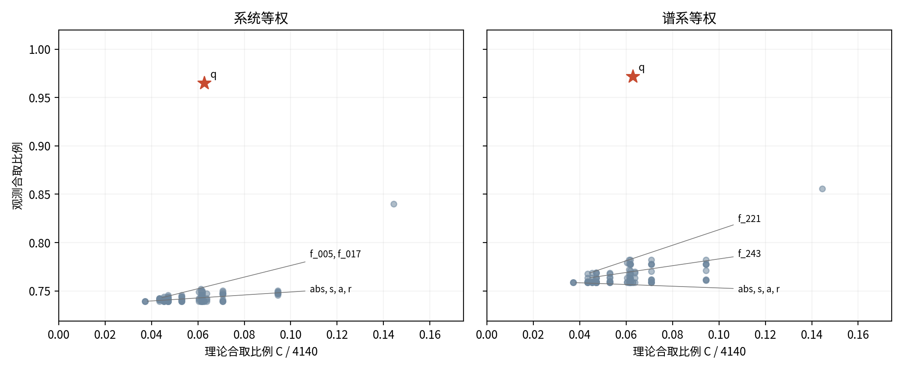
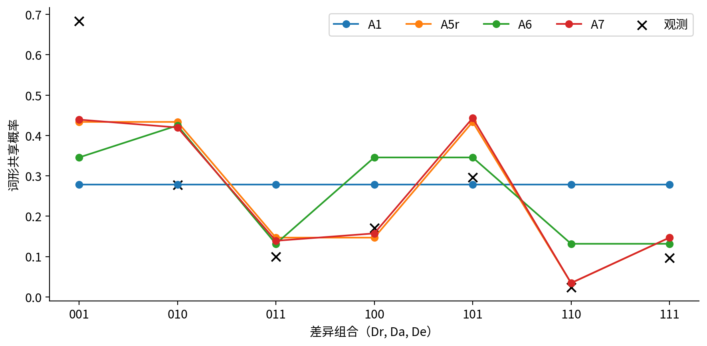

**摘要：** 兄弟姐妹称谓的规则性如何联系关系表征、局部区分与体系差异，是解释词汇范畴组织的重要问题。本文以Kinbank中的625个严格划分系统为主样本，建立覆盖完整划分空间的概率模型，结合候选基底比较、位置对照与跨群组验证考察竞争解释。结果显示，保留所指者性别的相对基底具有较强的跨谱系预测优势，另一相对坐标没有同等收益；位置特征的额外预测增量则不稳定。年龄区分集中于同性配置，但男男与女女的相当性尚未得到证实。差异交互与位置模型的类别对排序能够跨地域保持部分优势，概率偏差却不能仅归于共享基准率。本文据此提出联系关系压缩、局部选择与分布混合的解释框架，指出语义规律的理论价值在于界定可重用的表征及其作用条件，并区分类型组织、总体预测与形成机制。

**关键词：** 亲属称谓；兄弟姐妹；关系表征；合取；划分模型；语义类型学

## 一、引言

兄弟姐妹关系具有相近的生物学基础，其词汇表达却呈现明显的跨语言差异。英语brother与sister、德语Bruder与Schwester、俄语брат与сестра主要区分所指者性别；日语ani、otōto、ane、imōto以及汉语“哥哥、弟弟、姐姐、妹妹”还区分长幼。另一些语言把说话者与兄弟姐妹是否同性纳入称谓。亲属分类因而不仅涉及可用的语义维度，也涉及这些维度如何共同界定词项的适用范围。性别、长幼与参照者等维度早已进入亲属语义研究（Kroeber，1909），但特征的组合方式仍需进一步解释。

相同的特征清单可以产生不同的称谓结构。性别可以区分全部兄弟姐妹，也可以只在年长者中形成对立；年龄可以普遍适用，也可以仅区分同性兄弟姐妹。经典成分分析由此提出三类相互联系的要求：词项能否由特征值的合取定义，区分能否按层级展开，以及次级区分是否偏向特定一侧（Kronenfeld，1974）^490-491^。约束排序与亲属术语生成理论则从不同形式体系解释称谓组织（Jones，2010；Read，2007）。这些理论分别关注类别外延、结构关系和生成过程，比较时需要明确其经验对象。

大规模数据库使结构比较能够超出少数典型语言，同时也要求区分词形、范畴与历史关系。数据库中的形式选择受到来源记录影响，称谓类型又具有谱系分布（Passmore et al.，2023；Pericliev，2017）。两个关系类别共用词形，并不必然意味着它们属于同一个不可再分的语义范畴；同一语言内的类别对以及同源语言之间，也存在不能忽略的依赖。跨语言共性因而需要同时接受测量和推广范围的检验。

上述问题还涉及统计表示的选择。同一套称谓中的类别对共享同一个划分，其合并关系必须共同满足传递性；把这些类别对分别回归，所得总体交互既可能反映系统内的条件组织，也可能来自不同体系的混合。若要比较解释，就需要先对整套类别组织赋予概率，再导出类别对的共享率，使结构偏好与总体预测接受同一资料的检验。

本文围绕三组问题展开：在控制类别数之后，相对性别基底能否提高未见谱系上的整套划分预测；年龄区分究竟偏向同性配置，还是偏向男性所指者；整套划分的分布能够解释多少总体非加性，其预测又能在何种环境中保持？研究将划分概率模型、全部候选特征比较、位置对照和地域诊断相结合，并以跨领域资料检验关系表征的可复用性。理论解释由这些比较共同约束，重点说明表征资源、局部区分及体系分布如何参与词汇范畴的组织。

## 二、文献综述

### （一）表征理论：类别的简洁性由什么决定

亲属语义的成分分析提出了一个持续影响后续理论的问题：同一指称集合可以由不同概念方案描述，分析者需要在变量数量、规则重用和同音解释之间作出选择（Goodenough，1956）^211-213^。其理论价值并非只在于提供特征清单，而在于揭示语义规则相对于表征语言的简洁性。Lounsbury又指出，语义特征既可具有独立语音形式，也可隐含于不可再分的词项对立中（Lounsbury，1956）^161-162^。据此，语义组织与形式分解应当建立对应，而不能直接等同。

这一视角使相对性别具有特殊理论意义。“同性关系”在绝对性别坐标中包含不同位置，却可以在关系坐标中获得共同描述。一般概念理论把对象、特征与关系作为可组合资源，亲属学习模型则通过集合运算表示复杂词义（Kemp，2012；Mollica & Piantadosi，2022）。关系特征由此既可能增加抽象要求，也可能在掌握后降低描述成本。合取性的跨语言比较需要同时检验类别分布及其基底，而不把某一坐标下的复杂性当作类别本身的固定属性。

生成理论进一步把体系内部的联系置于解释中心。Jones以相互冲突的约束及其排序说明不同类别结构如何形成，Read则强调亲属术语之间的生成运算（Jones，2010；Read，2007）。两者都要求从局部词义走向可共同组织的体系，但前者着重候选结构的选择，后者着重关系的计算。这使本文需要区分三个问题：类别能否得到简洁表达，整套类别是否构成一致结构，以及该结构如何生成可观察的词形共用。

### （二）选择压力：学习经济性与交际区分如何共同作用

效率理论把结构规律解释为不同成本之间的权衡。Kemp与Regier允许合取和析取，通过最短规则描述与交际信息损失比较体系；合取优势是这一比较产生的倾向（Kemp & Regier，2012）^1050,1053^。信息损失还取决于交流需要，故某项区别是否值得维持，不能只由类别数量判断（Kemp et al.，2018）。这提供了从结构集中走向形成机制的理论桥梁。

学习与交际能够形成相近的规则性，却具有不同预测。简洁学习偏好有利于可压缩的类别，信息压力则可能要求保留更多区分；领域通用偏好的具体结果又依赖输入被如何表示（Carr et al.，2020；Culbertson & Kirby，2016）。因此，规则整齐本身不能独立判定压力来源。需要比较哪些关系容易被概括，以及哪些关系在使用中必须被区别。

Hallam等人的特征权重理论将语义与词形相似度相联系，并通过关系抽象的代价与文化区分需要解释特征作用；其Navajo分析已明确包含局部条件区分（Hallam et al.，2025a）^5833-5836^。本文与该理论的对话由此落实为：在整套划分的描述成本之外，条件位置能否提供独立的预测增量，以及这种关系如何迁移到未见群组。对称性研究同样将规则视为可被文化与功能压力调节的偏好（Kemp，2026）。它们共同支持分层比较，避免将整个效率传统缩减为一个无条件的加性模型。

### （三）标记性与历史：一般规律如何形成不同方向

经典层级理论提出性别、年龄与相对性别的三类侧向要求，并以未标记侧原则概括其中两项；同性侧年龄区分则另有角色排序的功能解释（Kronenfeld，1974）^491,496^。这一理论把不对称转化为可比较的结构问题；具体哪一侧具有默认地位，又受到文化与历史条件影响（Hage，1997）^662-663^（Hage，2001）^204-205^。因此，普遍的组织问题与特定取值的方向性需要分别检验。在相关三级划分中，参照者性别可由其他关系特征替代，也进一步表明合法分解并不唯一（Kronenfeld，1974）^498-499^。

历史研究的理论贡献，是区分可能的体系与实际变化路径。兄弟姐妹的年龄和相对性别可以具有不同历史（Jordan，2011）；对堂表亲类型的跨语系比较也发现，共享局部转变不必意味着遵循同一总体过程（Passmore & Jordan，2020）。堂表亲复杂度与社会实践及共享历史的关联，以及班图堂表亲类型与社会组织共同演化证据的有限性，则要求解释落实到具体意义维度和变化条件（Rácz et al.，2020；Guillon & Mace，2016）。社会背景由此进入结构的形成过程，而不只是给类型加上一组外部标签。

系统协调也不等于纯类型的一致。跨亲属世代的共选与体系内部可预测性分别揭示局部组织间的联系，允许规则与混合并存（Passmore et al.，2021；Hallam et al.，2025b）。本文据此把单语言的结构兼容、跨谱系方向及跨地域预测分开考察：它们检验的是规律在不同组织层次和环境中的保持程度。

### （四）共词化理论：共享形式对应什么样的语义联系

共词化研究使语义理论必须明确观察单位。同一词项的共词化与派生、复合等宽松联系承载不同层次的语义关联；亲属修饰词还可以用可组合表达细化较粗类别（François，2008）^170-172^（Kronenfeld，2006）^216^。数据库的规范化与同义项处理会改变同形判断，因此观察到的共享网络是语义结构与记录方式共同作用的结果（Rzymski et al.，2020）。

概念关联研究进一步修正了简单相似度解释。相似性与联想具有不同贡献，交际区分需求又可抑制相关意义的合并，强关联与完全同形之间因而未必保持单调关系（Xu et al.，2020；Karjus et al.，2021；Brochhagen & Boleda，2022）。情绪共词化同时表现出共享组织与文化地域差异，说明结构共性可以与语境差异共同存在（Jackson et al.，2019）。这些理论使亲属称谓的解释需要同时关注关系的接近性、具体混淆任务及表达层次。本文将它们落实为整套划分、局部配置与测量定义的联合比较，并在讨论中说明其不同经验后果。

## 三、数据与方法

### （一）资料与完整划分

资料来自Kinbank，并使用Glottolog的谱系与宏观地域分类。数据库采用可追溯的亲属位置编码与来源记录，便于在保持同一分析单位的条件下比较体系（Passmore et al.，2023；Forkel et al.，2018）。主资料包括939个八类齐全的记录系统、125个谱系组，每系统有28个无序类别对。“系统”指同一资料ID下记录的一套称谓，不将记录数量等同于独立语言数或独立历史创新数。

划分分析使用其中每类只有一个规范化词形的625个系统，涉及108个谱系组。八个关系位置由参照者性别$s$、所指者相对参照者的年龄$a$、所指者性别$r$共同确定；各变量的0值依次为男性、年长、男性。相对性别$q=s\oplus r$，0表示同性。相同词形把八位置组成互不重叠的词项外延，全部可能的无标签划分共4140种。模型对这一完整空间求和，不只对观测到的类型赋予概率。

单词形条件使词形相等构成等价关系。为考察样本选择，另将全部939系统分别按“词形集合完全相同”和“共享图的连通分量”形成划分。前者保留集合相等，后者使用共享关系的传递闭包；两者各有明确的观察含义。类别对分析仍保留原始的集合交集非空定义，并比较集合相等、严格单词形、排除含空格形式及词元共享等既有口径。多种定义用于识别表达层次与记录方式对结果的影响。

### （二）描述语言与候选特征

绝对语言$L_{abs}=\{s,a,r\}$、相对语言$L_{rel,r}=\{q,a,r\}$及$L_{rel,s}=\{q,a,s\}$都能唯一标识八个位置。两种相对坐标分别保留所指者与参照者性别，分别评估。四特征语言$L_{all}=\{s,a,r,q\}$允许不同词项使用不同坐标。合取性要求每个词项的外延恰好由若干特征取值的交集定义，不额外要求整个体系具有唯一的递归切分顺序。

描述长度使用最小析取范式的文字数：穷举可用的合取项，以精确集合覆盖求出每个词项的最短定义，再将全部词项成本相加。一个文字指一个特征及其正值或负值，全集可由零文字真式表示。该编码允许析取与合取，对应一个明确的逻辑表达语言；其思想与规则长度及逻辑程序研究相接（Kemp & Regier，2012；Mollica & Piantadosi，2022）。为比较库存成本，另计算$DL+\lambda d$，其中$d$为语言特征数，$\lambda$依次取0、1、2、3。同一语言内的固定附加项在概率归一化时抵消，故该扫描用于跨语言描述成本比较。

基底检验还穷举八位置全部127个非平凡二分，以互补去重。每个候选$f$加入绝对语言后，计算理论合取划分数$C_f$、观测合取系统数$N_f$及富集度$E_f=(N_f/625)/(C_f/4140)$；同时报告谱系等权口径。随机参照保持每系统词项数与块大小，对同形状划分均匀抽样。对称性另区分全局性别互换后特征值保持不变，以及允许二分两侧交换的情形。

### （三）划分概率模型与留出评价

对划分$\pi$建立精确归一化的最大熵分布：

$$P_\theta(\pi)=\frac{\exp[\theta^\mathsf{T}\phi(\pi)]}{\sum_{\pi'\in\Pi_8}\exp[\theta^\mathsf{T}\phi(\pi')]}。$$

A0为4140种划分的均匀分布；A1以类别数$k$及$k^2$控制区分数量；A2加入绝对基底合取指示，A3分别加入两种相对基底合取指示；A4、A5、A6分别使用绝对、相对及四特征语言的描述长度。A7在选中的描述模型上加入三个严格位置方向：年长侧性别区分、男性所指者侧年龄区分、同性侧年龄区分。预测方向记为+1，相反方向为−1，不适用为0；它们沿用根与子根兼容的严格判定，区别于下文更广的配置对照。

主评价沿用谱系整组五折，另做留一宏观区域及语言五折。严格样本只在原折中取子集，不重新平衡。训练及评分均以谱系等权为主，语言等权另报。分组验证使评价对象对应未见祖源或未见地域，符合依赖资料的验证原则（Roberts et al.，2017）。每个外层训练集内，先用谱系三折选择描述基底与L2强度，再固定该基底，为A7选择强度；候选强度为0、0.01、0.1、1。内层合并全部折外结果后按谱系评分，外层测试资料不参与选择。

划分指标为每系统平均留出对数概率，单位nats，越高越好。模型差的区间来自5000次固定折外预测的整谱系重抽；系数区间对主全样本A7另作5000次整谱系重拟合。两类区间分别反映预测分数的谱系组成变化与系数拟合变化（Cameron et al.，2008）。原结果已知后，本轮模型及指标在计算前写定；推断仅使用通过梯度、有限性与概率归一检查的拟合，完整规格及求解说明见补充资料。

模型还导出每个类别对的共享概率$\sum_\pi P_\theta(\pi)I(\pi_i=\pi_j)$，与严格样本同折重拟合的M0—M4比较。M0为三项差异的加性模型，M1增加相对性别差异，M2含全部两两差异交互，M3区分28对，M4再显式编码局部位置。配对模型沿用无惩罚估计及预置Firth替代，岭惩罚为敏感性（Firth，1993）。类别对工作似然、谱系稳健协方差与仅含谱系随机截距的模型分别报告，区分依赖处理的不同条件（Jaeger，2008）。从划分分布抽样检查类别数、合取及位置比例，并比较导出共享率的非加性；拟合分布检查与留出预测承担不同检验任务。

### （四）位置对照、地域诊断与跨领域检验

在每个严格系统内，记$A$为存在长幼区分的性别配置集合。配置MM、MF、FM、FF的首字母为参照者、次字母为所指者；$0<|A|<4$为偏性年龄系统。预列对照为仅同性与仅异性配置、仅MM与仅FF、仅FM与仅MF、仅男性与仅女性所指者配置。另分别在男性、女性参照者内比较年长与年幼侧的性别区分。系统计数与谱系内方向多数分别报告，平局单列，六项对照各自作Holm校正。

MM与FF的相当性以相关谱系方向比例差为主量，边界固定为±0.15，只有整谱系95%区间完整落入边界才支持相当。精确A类型的谱系众数另作敏感性，不与方向多数混用。分别排除两大谱系及分宏观地域的结果完整保留。

地域诊断并列原始留出损失、固定斜率后重估一个截距偏移的损失及谱系等权AUC，再对六区域等权平均。截距偏移使用留出区域的真实结局，属于校准诊断。全部共享定义、估计方法、权重和验证目标构成60种规格，三项主要模型增益均附整谱系区间。

跨领域分析使用相同资料ID中完整单词形的堂表亲、长幼父母同胞及普通父母同胞资料。主要关系指标为以$q$替换$s$、保留$r$后是否降低最小描述长度；按谱系分层的条件logit控制两领域各自类别数，并在谱系与两个类别数的相同层内作5000次蒙特卡洛置换。该部分单列为探索性，报告实际贡献信息的谱系及不可估计情况。历史解释结合既有研究与分类树可行性核查，具体转移过程留待具有相应时间信息的资料检验。

## 四、结果

### （一）基底的描述收益及留出预测

绝对基底下，625系统中有163个非合取；加入相对性别后的四特征语言仅余22个，扩展六特征为21个。两种三特征相对坐标的结果却显著不同：保留所指者性别时，多数体系获得简洁描述；保留参照者性别时，描述成本上升（表1）。

表1　四种描述语言的合取覆盖与平均长度

|语言|基本特征|合取系统数|谱系等权平均DL|
|---|---|---:|---:|
|绝对|s、a、r|462|8.6571|
|相对r|q、a、r|600|7.3889|
|相对s|q、a、s|279|14.8186|
|四特征|s、a、r、q|603|7.3130|

全部127个候选第四特征中，q的观测合取覆盖603个为最高，理论合取划分数为260；其系统富集度为15.3626，排名第48。绝对语言的理论合取划分数为154，富集度为19.8720。覆盖与富集因此给出不同排序（图1）。固定块大小参照下，q的合取系统数期望约106.93，95%预测区间为[90.98, 123.00]，实际覆盖明显集中。全局性别交换下有7个特征值保持不变的二分，另8个交换两块标签；两类共15个无标签稳定二分。

图注：各点为一个候选二分；q的高观测覆盖与富集排序分别解释。两个面板分别按系统与谱系等权。

不计库存成本时四特征语言平均长度最低；λ取1至3时，保留r的三特征相对语言最低。两者的谱系平均成本交点约为0.0759。λ扫描改变跨语言成本排序，但在固定语言的概率模型内部抵消。

表2　严格样本的谱系留出划分预测

|模型|类别数之外的组织信息|平均留出log概率|
|---|---|---:|
|A0|均匀分布|-8.3285|
|A1|仅k、k²|-8.0695|
|A2|绝对合取|-5.9548|
|A3r|相对r合取|-4.7936|
|A3s|相对s合取|-7.4858|
|A4|绝对DL|-6.0429|
|A5r|相对r的DL|-4.4762|
|A5s|相对s的DL|-8.0946|
|A6|四特征DL|-4.8497|
|A7|训练内选择的DL／合取模型加位置项|-4.4599|

表注：单位为每系统nats，越高越好。各外层训练内选择描述模型与正则化强度；A7的基底在本主条件中均为A5r。

相对r与绝对合取模型的增益为1.1612，95%区间[0.7807, 1.5435]；描述长度模型的相应增益为1.5667，[1.0205, 2.0858]。相对s的对应增益为−1.5310与−2.0517，区间均低于零。两种939系统映射、两种权重及三种验证目标的全部18规格中，相对r的两项点增益均为正，相对s均为负。

### （二）位置方向与竞争解释

严格层级方向复现了年长侧51／6、男性侧17／5、同性侧81／1的系统计数。更广的配置检验共有130个偏性年龄系统、74个偏性性别系统，六项对照见表3。

表3　配置对照的系统与谱系证据

|对照左侧／右侧|系统计数|谱系多数计数|谱系Holm p|
|---|---:|---:|---:|
|仅同性／仅异性|91／2|21／2|0.0004|
|仅男男／仅女女|4／1|3／1|1.0000|
|仅女男／仅男女|0／0|0／0|—|
|仅男性／仅女性所指者|24／6|15／4|0.0576|
|男性参照者：年长／年幼性别区分|55／7|21／3|0.0011|
|女性参照者：年长／年幼性别区分|57／8|23／3|0.0004|

同性配置显著多于异性配置。男性所指者侧在系统计数上较多，但谱系六项校正后p=0.0576。男男与女女的主谱系差为0.50，95%区间[−0.50, 1.00]，远未进入±0.15等价边界；异性两单侧的直接对照没有适用系统。男性、女性参照者中均出现年长侧的性别区分优势。精确类型众数、排除两大谱系与分区结果保留在补充表中，不能由总体方向推作各区域普遍律。

A7相对同折选中描述模型的增益仅0.0163，95%区间[−0.0600, 0.0886]。全样本P2、P3、P4系数分别为1.1423、0.2974、0.8015；其95%谱系重拟合区间依次为[0.3594, 1.7985]、[−0.0501, 0.6497]、[0.3775, 1.2224]。年长侧与同性侧系数在Bonferroni区间下仍为正；这一条件关联与未见谱系上的预测增量属于不同结果。

### （三）类型分布、总体交互与模型缺口

主A5r没有显式类别对交互项，仍导出约3.0765的所指者性别差异×参照者性别差异交互，严格样本M2对应值为2.7379。其性别差异×年龄差异约为0，年龄差异×参照者性别差异约为0.0918，实测对应值却为1.6040与0.7873。A7的后两项为0.0484与0.1231，仍未恢复全部年龄相关交互（图2）。

图注：共享率由完整划分分布精确求和。相同差异型内部的端点位置及全模型结果另见补充资料。

拟合分布检查也显示结构缺口。A7中四词项系统的谱系等权比例观测为0.4316，模型期望为0.2477，观测超出95%合成区间；绝对合取比例亦未被对应区间覆盖。在同折类别对预测上，A7相对M2的损失增加0.0271，区间[0.0040, 0.0495]；相对M4增加0.0277，[0.0052, 0.0498]。划分模型的联合表示收益没有同时转化为更低的类别对损失。

### （四）地域推广与跨领域复用

表4并列严格样本的类别对损失和地域诊断。M2与M4在六区的AUC均高于M0，原始及截距校准后损失却仍均高于M0。截距调整虽匹配共享基准率，尚不能消除概率偏差。

表4　类别对预测及六区域宏平均诊断

|模型|严格625谱系留出损失|地域原始损失|地域校准诊断损失|地域AUC|
|---|---:|---:|---:|---:|
|M0|0.4595|0.5397|0.5135|0.7299|
|M2|0.4438|0.5475|0.5203|0.7576|
|M4|0.4432|0.5468|0.5194|0.7540|

表注：地域内谱系等权，地域间等权；缺失地域不补值。校准使用测试区真实结局，仅作诊断。严格样本与地域诊断的样本、验证对象不同。

全部60种类别对规格及180项增益区间均保留。谱系稳健区间与既有重拟合区间对男性侧条件项均跨零；仅谱系随机截距的五个未加权VB模型收敛，其近似区间与主加权推断分列。

探索性跨领域资料中，堂表亲有192个完整配对系统、43个谱系组，其中32系统在相对r基底下有压缩收益。条件logit实际依赖5个谱系、135系统，优势比约1079.66，但95%区间为[0.0312, 37397057.50]，Holm p=0.2743，幅度很不确定。固定谱系与两个类别数的蒙特卡洛置换在3层、17系统内得到Holm p=0.0084；这些层仅来自2个谱系，检验对象较窄。长幼父母同胞351系统及普通父母同胞96系统的主要关系指标均为零，关联无法估计。跨领域复用因而呈领域和信息范围差异。

## 五、讨论

### （一）关系表征的收益来自与所指者锚点的配合

本研究最清楚的结果，是相对性别的收益依赖它与哪个性别坐标共同使用。保留所指者性别、以相对性别替换参照者性别时，类别描述更短，未见谱系上的划分概率更高；反向替换则使两项指标都变差。三种完备坐标包含相同的关系信息，区别在于哪些事实可直接调用、哪些事实须由其他关系重建。语义简单性因此体现为表征资源与实际类别分布的匹配，而非一个脱离描述语言的固定属性。

这深化了成分分析关于不同概念方案的讨论。Goodenough把变量数量、规则简洁性与同音分析放在同一个解释问题中，指出相同用法可有不同的概念组织（Goodenough，1956）^211-213^。本研究进一步把这种选择转化为可比较的预测：在相同信息量与相同类别数控制下，不同基元安排对实际类型具有不同适应性。仅按所指者性别区分的词项，在含r的语言中可以直接描述；若只保留s和q，就必须将两种性别匹配配置合并。与此同时，同性关系在含q的语言中可以直接重用。保留r与q同时兼顾了对象属性与双方配置，较好地适配了观察到的称谓边界。

这种分工与所指者在命名任务中的作用相联系。Hallam等人区分了关系抽象的学习代价与指称信息的收益，指出所指者性别可以直接缩小指称集合，而说话者性别本身不缩小其所谈论的亲属范围（Hallam et al.，2025a）^5836^。称谓既需要确定谈论的是谁，也需要确定其相对于参照者处于何种位置。r提供前一种锚点，q把后一种配置压缩为可重用条件。参照者仍然参与关系的确定，但其绝对性别可以通过双方的关系推得。本文的结果支持在这一分工中理解相对性别，而不是把参照者视为语义中可有可无的成分。

关系计算与属性提取也由此成为互补过程。Kemp把对象、特征与关系作为概念组合资源，Read则强调亲属术语能够参与进一步的生成运算（Kemp，2012；Read，2007）。它们的理论价值在于说明，词义能够借助已有关系产生新的指称，而不只列举对象的属性。本文的坐标比较显示，这种生成资源具有选择性：关系特征与直接锚点的组合可以节省表达，但使所指者性别须经参照者性别与q重建会增加成本。可以由此提出更具体的学习预期：当所指者属性容易获得、参照角色反复改变时，直接属性与相对配置的组合应更利于跨人物概括；这种优势应体现在新实例推广，而不仅是记住已有词表。

### （二）合取偏好需要同时解释覆盖、表达成本与库存选择

q获得最大的观测合取覆盖，说明它对资料中的大量类别具有共同的描述作用；富集度未居首位，则表明提高覆盖与提高选择性并非同一件事。增加一个特征会扩大可以被单个合取式定义的集合，分析者需要同时衡量实际收益和理论允许范围。若只以能解释多少体系决定基底，就容易奖励更宽的表达能力；若只以富集度决定，又可能偏向保留很小但本已集中的允许空间。两种指标分别刻画理论的包容范围与分布集中程度，需要联系起来判断。

三维基底的直接比较对此提供了更有力的约束。三套坐标都是对八位置的完整重编码，理论上允许的合取划分数量相同；其模型复杂度也相同。相对r优于绝对基底的留出结果，因而具有超出“增加特征后覆盖自然提高”的含义：同样规模的表达资源，与实际分布发生了更好的配合。q在候选遍历中的覆盖、相对r在等容量比较中的预测、另一相对坐标的反向结果共同表明，有解释力的资源应当能在固定的组合条件下重用，而不能随词项任意增设。

Kemp与Regier允许合取和析取，通过描述成本与交际信息损失解释类别空间中的集中（Kemp & Regier，2012）^1050,1053^。其理论价值正是把实际类型放回包含替代结构的空间，使规则性成为需要解释的分布偏好。Mollica与Piantadosi的程序语言也容许多种集合运算，并给较长程序更高成本（Mollica & Piantadosi，2022）^771-772^。本文的精确DNF比较延续了这一思路：非合取类别仍可描述，只需更多逻辑材料。合取高频因此可以表现为较低编码成本区域的集中，同时保留具体例外的可比较性。

相对性别的变换性质为它提供了独立的理论动机。双方性别一起交换时，同性与异性关系的值保持不变，使不同人物配置能够共享一个条件。不过，类别关系的对称性还允许两块交换标签：按所指者性别划分也可在交换后保留“哪些位置同类”的关系。Kemp的对称性理论使用的正是后一层次的类别关系不变（Kemp，2026）。因此，q的保值性说明它具有明确的关系意义，r的标签交换则说明直接属性同样可以参与对称组织；对称性提供候选约束，具体优劣仍由分布与预测决定。

库存成本进一步说明表达收益需要付出何种代价。四特征语言在不收费时略短，而一个较小的库存收费已足以使三特征相对r语言更经济。这里比较的是不同语言库存的成本；同一语言内的固定成本在归一化时抵消，无法由该语言内部的体系分布估计。更深的理论问题是，q何时能够成为可直接调用的基元。Culbertson与Kirby指出，领域通用的简洁偏好依赖输入的表示，并可在传递中被放大（Culbertson & Kirby，2016）。因此，分布中的压缩收益可以为关系学习提供优势，却还需要互动与传承解释这一资源如何变得可用。基底比较把这种解释具体化为“哪些关系值得学习并反复调用”，而不是预先假定所有逻辑等价表达具有相同认知成本。

### （三）局部区分更接近关系内部排序，但性别对称仍是开放问题

年龄区分明显集中在同性配置，这使关系内部的排序成为一个有力解释。同性关系已经固定双方在性别上的共同位置，年龄可以进一步组织同类角色间的长幼顺序；异性配置则已包含另一种角色差别，其年龄细分未必具有相同收益。这一解释关注的是一个维度在既有关系框架中增加了什么信息。它能够把“为什么出现区分”与“区分为何集中在这一侧”联系起来，比单独给某个性别附上固定优先性更贴近目前的对照结果。

Kronenfeld曾以同类角色内部的地位辨认解释同性侧的年龄细分，并讨论继承、职位等关系如何产生额外区别（Kronenfeld，1974）^496^。其中关于普遍男女地位的具体前提需要放回其材料背景，但角色框架中的相对辨认需要仍具有理论价值。当一个关系类别已将参与者归为同类，继续区分长幼可能直接服务于称呼、资格或行动次序；词汇边界由此可以保存互动中反复需要的对比。该机制的经验目标是局部混淆或角色后果，而不是亲属在一般生活中出现得多不多。

标记性理论为这种局部性提供了另一种表达。Kronenfeld把若干侧向要求概括为在未标记侧继续细分，同时把男性、年长项纳入当时的解释（Kronenfeld，1974）^491,496^。Hage则指出，年龄标记会随文化与历史而变；年长者的特殊继承职责甚至可能使其成为标记项（Hage，2001）^204-205^。这些论述表明，默认范围、形式复杂性与社会重要性需要分别诊断。本文在两种参照者性别下都观察到年长侧性别细分，较支持该年龄位置的稳定组织作用；它尚不能独立决定这一作用来自默认值、社会职责还是学习中的显著性。

男男与女女的直接对照构成两种解释最关键的分界。同性集中与男性优先可以在部分系统中重叠，只有比较两个同性配置，才能判断同类排序是否还伴随独立的男性优势。目前适用谱系过少，无法建立相当性，故关系排序解释获得的是同性与异性的对照支持。其关于两个同性配置相近的进一步预测仍需更多可比资料。这一结果并没有削弱直接对照的价值：它指出了竞争理论共享的预测与真正能区分它们的预测，使新增资料应集中在哪些体系上更为明确。

Faris的Nuba分析还说明，参照位置可以因继嗣情境而成为称谓规则的重要条件；其多义分析把某些表面同形重新联系到具体角色，而非直接视为特征缺失（Faris，1969）^484,486-487^。这提示局部区分应由关系中的实际身份和任务解释。Hallam等人已在效率分析中讨论局部条件的文化区分需要（Hallam et al.，2025a）^5833-5836^；本文把其中一组预测转化为显式配置对照，并进一步检查其在划分分布中的增量。A7的年长侧和同性侧系数为正，却没有确立稳定折外增益，说明局部方向能够组织适用子集，同时可能已被更一般的描述偏好部分吸收。局部规律在体系中的位置与其对总体预测的独立贡献，应当作为互相联系的两个解释问题。

### （四）类型混合解释了部分非加性，也暴露了压缩模型的不足

划分模型使总体交互获得了一个可检查的来源。每个系统先有一套合法类别，类别对共享率再由这些类型的分布导出；同一词项中的位置合并因此共同变化。相对性别又把双方绝对性别联系起来，在原始性别差异坐标中自然形成依赖。模型没有显式类别对交互，仍产生较强的所指者性别差异与参照者性别差异交互，说明这一部分总体非加性可以由关系基底及类型分布共同产生。观察到一个总体交互，并不要求每套语言都含有对应的复杂局部规则。

年龄相关交互却没有以同样程度出现。这使“体系混合”从一个宽泛可能性变为有明确边界的解释：给定本研究的类型权重规则，它能产生某些相依关系，却仍遗漏了相当一部分长幼组织。加入严格位置特征后缺口依旧，说明单一的总体描述长度加少数递归方向，还不足以概括所有区别的配置。年龄在词项中的作用可能依赖更多局部组合，也可能具有与性别不同的使用权重。现有差异提供了这种进一步解释的目标，而不是把全部剩余交互归入一个未分解的复杂性参数。

拟合分布中四词项体系的不足具有相同含义。对类别数及其平方的控制约束了相应矩，但不固定完整的类别数分布；平均描述成本也没有决定同成本类型之间应如何分配概率。最大熵模型把已提供的统计特征扩展到全部合法划分，其遗漏由此揭示还需要哪种结构信息。实际体系可能集中于少数特定的四词项组织，而不是在同样简洁的候选之间均匀分布。概括描述成本与识别具体构型的偏好，因而具有不同的理论任务。

这一分工有助于理解学习与交际解释的关系。Carr等人指出，简洁性与信息性都能形成紧凑类别，却对保留多少区分具有不同预测（Carr et al.，2020）。Hallam等人的推广研究也区分体系可预测性的压缩价值与表达能力（Hallam et al.，2025b）。本文的划分模型较好定位了关系基底，却未达到类别对回归的概率准确度，正说明“哪些体系易于描述”与“哪些区别在总体上更常保留”需要不同信息。前者由可重用规则提供约束，后者还需要具体角色、频率及区分收益决定不同规则的权重。

交际区分收益可以独立测量。Karjus等人保持各意义的总暴露频率相同，改变相似意义在同一选择场景中必须区分的频率，从而影响其合并倾向（Karjus et al.，2021）。Xu等人关于概念关联便利的解释，以及Brochhagen与Boleda关于语境混淆的分析，则说明概念接近既创造形式复用机会，也可能提高保留区别的价值（Xu et al.，2020；Brochhagen & Boleda，2022）。亲属的共同关系背景提供压缩基础，具体任务决定哪些位置值得继续细分。这使学习偏好与交际需求能够解释同一体系中同时出现的规则重用和选择性复杂化。

颜色研究为分开检验这两种作用提供了方法参照。知觉空间的非均匀结构可以影响类别形状，用途资料则可在命名结果之外测量需求（Regier et al.，2007；Gibson et al.，2017）。信息瓶颈及其扩展进一步把编码结构与交际需要放入共同权衡（Zaslavsky et al.，2018；Zaslavsky et al.，2019）。这些研究对亲属领域的启发，在于把关系空间、学习资源与混淆任务分别刻画。本文已定位基底能够解释的部分，年龄相关残余则为引入独立用途资料提供了具体检验对象。

### （五）地域排序与概率标定揭示不同的推广边界

地域结果显示，同一模型中不同层次的信息可以具有不同迁移范围。差异交互与位置模型在未见区域更善于排列哪些类别对容易共享，却没有给出更准确的共享概率；即使使用该区域真实结果调整截距，损失优势仍未出现。AUC保留的是排序，对数损失还惩罚概率幅度的偏离。这个分化表明，某些关系对比可以跨环境重现，而其区分强度及不同类型的比例仍依赖区域构成。

单一基准率不能解释全部差异，因为截距校准只改变整体共享倾向，并未消除剩余失配。不同特征作用的强度、类型组合或同一差异型内部的位置变化，都可能影响概率尺度。宏观区域又只是一个粗分组，同时容纳接触、社会实践及资料来源差异。分组验证的理论意义，是让这些作用在相应推广距离上接受检验（Roberts et al.，2017）。本文的结果将可迁移的排序信息与尚未迁移的概率准确度区分开来，为历史和功能解释提出了更细的对象。

历史研究说明，这种分化可以通过不同维度的变化路径形成。Jordan发现兄弟姐妹的年龄与相对性别具有不同的演化历史，因而不能把一个类型标签视为整体同步变化的单位（Jordan，2011）。堂表亲类型的跨语系比较也显示，各语系可以共享局部转换而不服从同一总体变化过程（Passmore & Jordan，2020）。这些文献的理论价值在于把可能结构与实际到达路径区分开：共享的表征资源可以限制变化空间，历史起点、传播与局部角色又改变各类型出现的概率。本文性别相关与年龄相关交互的解释程度不同，与这种维度化视角形成了明确对话。

词汇载体还会影响哪些区别一同传递。Jordan把意义打包与特征共变提出为后续检验方向（Jordan，2011）^315-316^；Hage对术语替换的分析则说明，对立中和后保留哪个词项会受到具体文化及时期的标记关系影响（Hage，1997；Hage，2001）。相同类别边界既可能随同源词的保存而延续，也可能由不同词根在相似角色条件下形成。若要识别这些路径，就需要将词源、时间顺序及关系维度联合起来，而不能由同步相似直接推出同一变化机制。

社会实践与词汇结构的关联也需经过这一历史层次。堂表亲复杂度与社会实践和共享历史的关系，以及班图亲属类型与社会组织共同演化证据的有限性，分别强调了具体维度与变化时序的重要性（Rácz et al.，2020；Guillon & Mace，2016）。制度改变后称谓可能继续保留，原有词汇又可能为后续区分提供结构支架。本文固定分类树只有拓扑尺度，不能承载关于真实演化时间的估计；但同步结果已经指出应追踪哪些变化：关系配置的保存、年龄细分的位置，以及类型比例在地域间的重组。历史解释由此具有可以与资料对应的路径，而不只是对群组差异的笼统归因。

### （六）关系复用具有领域条件，并通过不同表达层次实现

跨领域结果将“可复用”具体化为一个有条件的命题。堂表亲资料提供了关系压缩与兄弟姐妹压缩相联系的线索，但主条件估计只依赖少数谱系，幅度区间极宽；固定层内蒙特卡洛置换的信号又集中于更窄的同谱系、同类别数比较。父母同胞领域没有出现同样的主要压缩收益。这些结果更适合支持对关系资源作用范围的划分：同辈关系可能共享某些参照配置，跨代角色则由连接父母的一侧、长幼及所指者身份等资源组织。相同的逻辑运算可以跨领域使用，其实际节约取决于当地类别边界是否反复调用这一关系。

这种条件性与体系协调研究相接。Passmore等人的跨亲属世代共选揭示局部体系间存在联系，同时保留混合结构；Hallam等人的内部可预测性研究则说明，已有规则能够为新的命名位置提供支架（Passmore et al.，2021；Hallam et al.，2025b）。它们共同支持一种局部扩展观点：一个领域中已形成的关系可以降低相邻任务的学习负担，但各领域仍保留不同的区分目标。亲属术语模式的谱系信息也说明，观察到的协调既涉及结构资源，又包含具体传承（Pericliev，2017）。因此，复用不需要全体系成为同一种纯类型。

词汇与构式又为同一关系组织提供不同实现。Lounsbury指出，语义成分可以具有独立语音形式，也可以隐含在不可再分的词项对立中（Lounsbury，1956）^161-162^。hermano mayor与hermano menor由完整表达区分长幼，又共同使用hermano保留较粗类别；完整同形与共同词元追踪的是表达的不同层次。François对严格共词化及构词联系的区分、Kronenfeld对亲属修饰语的讨论，为分别考察这些层次提供了标准（François，2008）^170-172^（Kronenfeld，2006）^216^。Fanti的重叠外延例子还说明，规则性有时通过覆盖而非互斥划分实现（Kronenfeld，1974）^501^。

形式成本由此需要与类别描述成本连接。较少词根配合可组合修饰语，可以表达相当精细的区别；词根数、完整表达数和语义区分数因而具有不同含义。对形式与意义效率的联合建模，为区分这些代价提供了依据（Mollica et al.，2021）。数据库中的同义项、规范化与来源粒度又影响共享关系的观察，跨语言共词化资料中的共同结构和文化差异也同时存在（Rzymski et al.，2020；Jackson et al.，2019）。本研究将严格划分作为清楚的结构对象，再以多种词形定义检查其适用范围，正是为了把关系组织与表达实现接合起来。

综合这些比较，可以形成一个由不同证据约束的解释：所指者属性与双方关系提供可共同调用的表征，学习与传承有利于保留规则重用，具体角色中的区分收益影响细分位置，历史与地域过程改变体系的组合比例，词汇和构式则实现这些边界。关系基底的预测优势、位置证据的分化及年龄交互的残余，分别对应这一解释的不同环节。其价值在于把一个笼统的规则性问题分解为可相互检验的理论联系，使学习、使用和历史资料能够对同一类现象给出有区分力的说明。

## 六、结论

本文以完整划分分布比较兄弟姐妹称谓的竞争解释。保留所指者性别的相对坐标兼顾直接属性与双方配置，在等信息、等容量的比较中获得较短描述及更好的跨谱系划分预测；另一相对坐标的反向结果说明，关系表征的收益具有明确的组合条件。同性配置中的年龄区分得到支持，男男与女女的相当性仍未确立，位置特征也未形成稳定的额外留出增益。类型分布可以产生部分性别相关非加性，年龄交互与特定体系的集中仍构成解释缺口。

本文结合结果与文献提出一个仍需过程资料检验的解释框架：关系压缩描述哪些类别易于共同表达，具体角色与使用需求可作为区别保留位置的候选解释，历史与表达实现则为领域及地域分布提供进一步的解释路径。将三者落实到不同的预测量，使亲属语义研究能够从规律罗列走向有边界、可比较的理论解释。

## 数据可得性

研究数据、完整分析规格、补充图表及复现材料公开于 https://github.com/WuYusen825/kinship-semantic-interactions 。原分析与历史稿件单独保留；数据与文献遵循各来源许可。

## 参考文献

Brochhagen, T. & Boleda, G. (2022). When do languages use the same word for different meanings? The Goldilocks principle in colexification. *Cognition*, 226, 105179. https://doi.org/10.1016/j.cognition.2022.105179.

Cameron, A. C., Gelbach, J. B., & Miller, D. L. (2008). Bootstrap-Based Improvements for Inference with Clustered Errors. *Review of Economics and Statistics*, 90(3), 414-427. https://doi.org/10.1162/rest.90.3.414.

Carr, J. W., Smith, K., Culbertson, J., & Kirby, S. (2020). Simplicity and informativeness in semantic category systems. *Cognition*, 202, 104289. https://doi.org/10.1016/j.cognition.2020.104289.

Culbertson, J. & Kirby, S. (2016). Simplicity and Specificity in Language: Domain-General Biases Have Domain-Specific Effects. *Frontiers in Psychology*, 6, 1964. https://doi.org/10.3389/fpsyg.2015.01964.

Faris, J. C. (1969). Sibling Terminology and Cross-Sex Behavior: Data from the Southeastern Nuba Mountains. *American Anthropologist*, 71(3), 482-488. https://doi.org/10.1525/aa.1969.71.3.02a00080.

Firth, D. (1993). Bias reduction of maximum likelihood estimates. *Biometrika*, 80(1), 27-38. https://doi.org/10.1093/biomet/80.1.27.

Forkel, R., List, J.-M., Greenhill, S. J., Rzymski, C., Bank, S., Cysouw, M., Hammarström, H., Haspelmath, M., Kaiping, G. A., & Gray, R. D. (2018). Cross-Linguistic Data Formats, advancing data sharing and re-use in comparative linguistics. *Scientific Data*, 5(1), 180205. https://doi.org/10.1038/sdata.2018.205.

François, A. (2008). Semantic maps and the typology of colexification: Intertwining polysemous networks across languages. In M. Vanhove (Ed.), *From Polysemy to Semantic Change: Towards a typology of lexical semantic associations* (pp. 163-215). Amsterdam: John Benjamins Publishing Company. https://doi.org/10.1075/slcs.106.09fra.

Gibson, E., Futrell, R., Jara-Ettinger, J., Mahowald, K., Bergen, L., Ratnasingam, S., Gibson, M., Piantadosi, S. T., & Conway, B. R. (2017). Color naming across languages reflects color use. *Proceedings of the National Academy of Sciences*, 114(40), 10785-10790. https://doi.org/10.1073/pnas.1619666114.

Goodenough, W. H. (1956). Componential Analysis and the Study of Meaning. *Language*, 32(1), 195-216. https://doi.org/10.2307/410665.

Guillon, M. & Mace, R. (2016). A Phylogenetic Comparative Study of Bantu Kinship Terminology Finds Limited Support for Its Co-Evolution with Social Organisation. *PLOS ONE*, 11(3), e0147920. https://doi.org/10.1371/journal.pone.0147920.

Hage, P. (1997). Unthinkable Categories and the Fundamental Laws of Kinship. *American Ethnologist*, 24(3), 652-667. https://doi.org/10.1525/ae.1997.24.3.652.

Hage, P. (2001). Marking Theory and Kinship Analysis: Cross-cultural and Historical Applications. *Anthropological Theory*, 1(2), 197-211. https://doi.org/10.1177/146349960100100203.

Hallam, M., Kirby, S., Jordan, F., & Smith, K. (2025a). Efficient communication drives the semantic structure of kinship terminology. In D. Barner, N. R. Bramley, A. Ruggeri, & C. M. Walker (Eds.), *Proceedings of the 47th Annual Conference of the Cognitive Science Society* (pp. 5831-5837).

Hallam, M., Jordan, F. M., Kirby, S., & Smith, K. (2025b). Predictive Structure Emerges During the Generalisation of Kin Terms to New Referents. *Open Mind*, 9, 1431-1466. https://doi.org/10.1162/opmi.a.27.

Jackson, J. C., Watts, J., Henry, T. R., List, J.-M., Forkel, R., Mucha, P. J., Greenhill, S. J., Gray, R. D., & Lindquist, K. A. (2019). Emotion semantics show both cultural variation and universal structure. *Science*, 366(6472), 1517-1522. https://doi.org/10.1126/science.aaw8160.

Jaeger, T. F. (2008). Categorical data analysis: Away from ANOVAs (transformation or not) and towards logit mixed models. *Journal of Memory and Language*, 59(4), 434-446. https://doi.org/10.1016/j.jml.2007.11.007.

Jones, D. (2010). Human Kinship, from Conceptual Structure to Grammar. *Behavioral and Brain Sciences*, 33(5), 367-381. https://doi.org/10.1017/S0140525X10000890.

Jordan, F. M. (2011). A Phylogenetic Analysis of the Evolution of Austronesian Sibling Terminologies. *Human Biology*, 83(2), 297-321. https://doi.org/10.3378/027.083.0209.

Karjus, A., Blythe, R. A., Kirby, S., Wang, T., & Smith, K. (2021). Conceptual Similarity and Communicative Need Shape Colexification: An Experimental Study. *Cognitive Science*, 45(9), e13035. https://doi.org/10.1111/cogs.13035.

Kemp, C. (2012). Exploring the conceptual universe. *Psychological Review*, 119(4), 685-722. https://doi.org/10.1037/a0029347.

Kemp, C. & Regier, T. (2012). Kinship Categories Across Languages Reflect General Communicative Principles. *Science*, 336(6084), 1049-1054. https://doi.org/10.1126/science.1218811.

Kemp, C., Xu, Y., & Regier, T. (2018). Semantic Typology and Efficient Communication. *Annual Review of Linguistics*, 4(1), 109-128. https://doi.org/10.1146/annurev-linguistics-011817-045406.

Kemp, C. (2026). Symmetry in category systems across languages. *Nature Communications*, 17(1), 358. https://doi.org/10.1038/s41467-025-67463-4.

Kroeber, A. L. (1909). Classificatory Systems of Relationship. *The Journal of the Royal Anthropological Institute of Great Britain and Ireland*, 39, 77-84. https://doi.org/10.2307/2843284.

Kronenfeld, D. B. (1974). Sibling Typology: Beyond Nerlove and Romney. *American Ethnologist*, 1(3), 489-506. https://doi.org/10.1525/ae.1974.1.3.02a00060.

Kronenfeld, D. B. (2006). Issues in the Classification of Kinship Terminologies: Toward a New Typology. *Anthropos*, 101(1), 203-219.

Lounsbury, F. G. (1956). A Semantic Analysis of the Pawnee Kinship Usage. *Language*, 32(1), 158-194. https://doi.org/10.2307/410664.

Mollica, F., Bacon, G., Zaslavsky, N., Xu, Y., Regier, T., & Kemp, C. (2021). The forms and meanings of grammatical markers support efficient communication. *Proceedings of the National Academy of Sciences*, 118(49), e2025993118. https://doi.org/10.1073/pnas.2025993118.

Mollica, F. & Piantadosi, S. T. (2022). Logical word learning: The case of kinship. *Psychonomic Bulletin & Review*, 29(3), 766-799. https://doi.org/10.3758/s13423-021-02017-5.

Passmore, S. & Jordan, F. M. (2020). No Universals in the Cultural Evolution of Kinship Terminology. *Evolutionary Human Sciences*, 2, e42. https://doi.org/10.1017/ehs.2020.41.

Passmore, S., Barth, W., Quinn, K., Greenhill, S. J., Evans, N., & Jordan, F. M. (2021). Kin Against Kin: Internal Co-selection and the Coherence of Kinship Typologies. *Biological Theory*, 16(3), 176-193. https://doi.org/10.1007/s13752-021-00379-6.

Passmore, S., Barth, W., Greenhill, S. J., Quinn, K., Sheard, C., Argyriou, P., Birchall, J., Bowern, C., Calladine, J., Deb, A., Diederen, A., Metsäranta, N. P., Araujo, L. H., Schembri, R., Hickey-Hall, J., Honkola, T., Mitchell, A., Poole, L., Rácz, P. M., Roberts, S. G., Ross, R. M., Thomas-Colquhoun, E., Evans, N., & Jordan, F. M. (2023). Kinbank: A Global Database of Kinship Terminology. *PLOS ONE*, 18(5), e0283218. https://doi.org/10.1371/journal.pone.0283218.

Pericliev, V. (2017). Kin Term Patterns and Language Families. *Cognitive Studies | Études cognitives*, (17), 1374. https://doi.org/10.11649/cs.1374.

Rácz, P., Passmore, S., & Jordan, F. M. (2020). Social Practice and Shared History, Not Social Scale, Structure Cross-Cultural Complexity in Kinship Systems. *Topics in Cognitive Science*, 12(2), 744-765. https://doi.org/10.1111/tops.12430.

Read, D. W. (2007). Kinship Theory: A Paradigm Shift. *Ethnology*, 46(4), 329-364.

Regier, T., Kay, P., & Khetarpal, N. (2007). Color naming reflects optimal partitions of color space. *Proceedings of the National Academy of Sciences*, 104(4), 1436-1441. https://doi.org/10.1073/pnas.0610341104.

Roberts, D. R., Bahn, V., Ciuti, S., Boyce, M. S., Elith, J., Guillera-Arroita, G., Hauenstein, S., Lahoz-Monfort, J. J., Schröder, B., Thuiller, W., Warton, D. I., Wintle, B. A., Hartig, F., & Dormann, C. F. (2017). Cross‐validation strategies for data with temporal, spatial, hierarchical, or phylogenetic structure. *Ecography*, 40(8), 913-929. https://doi.org/10.1111/ecog.02881.

Rzymski, C., Tresoldi, T., Greenhill, S. J., Wu, M.-S., Schweikhard, N. E., Koptjevskaja-Tamm, M., Gast, V., Bodt, T. A., Hantgan, A., Kaiping, G. A., Chang, S., Lai, Y., Morozova, N., Arjava, H., Hübler, N., Koile, E., Pepper, S., Proos, M., Van Epps, B., Blanco, I., Hundt, C., Monakhov, S., Pianykh, K., Ramesh, S., Gray, R. D., Forkel, R., & List, J.-M. (2020). The Database of Cross-Linguistic Colexifications, reproducible analysis of cross-linguistic polysemies. *Scientific Data*, 7(1), 13. https://doi.org/10.1038/s41597-019-0341-x.

Xu, Y., Duong, K., Malt, B. C., Jiang, S., & Srinivasan, M. (2020). Conceptual relations predict colexification across languages. *Cognition*, 201, 104280. https://doi.org/10.1016/j.cognition.2020.104280.

Zaslavsky, N., Kemp, C., Regier, T., & Tishby, N. (2018). Efficient compression in color naming and its evolution. *Proceedings of the National Academy of Sciences*, 115(31), 7937-7942. https://doi.org/10.1073/pnas.1800521115.

Zaslavsky, N., Kemp, C., Tishby, N., & Regier, T. (2019). Color Naming Reflects Both Perceptual Structure and Communicative Need. *Topics in Cognitive Science*, 11(1), 207-219. https://doi.org/10.1111/tops.12395.
